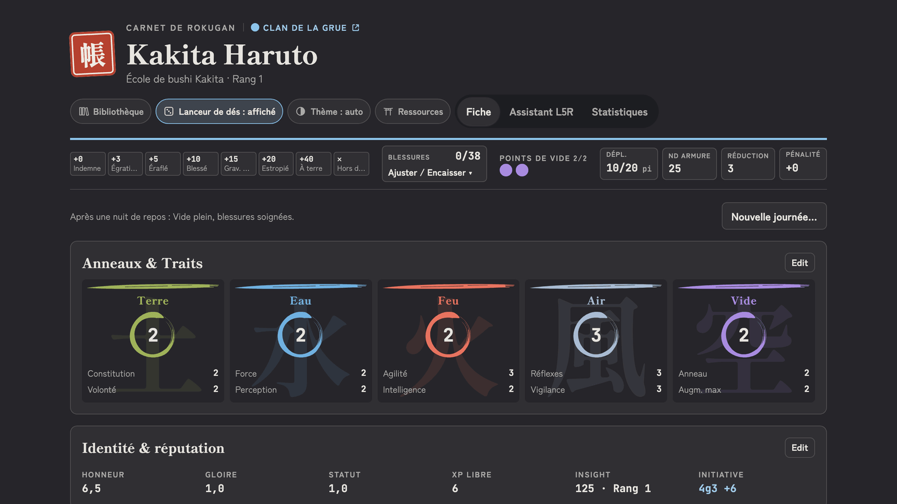
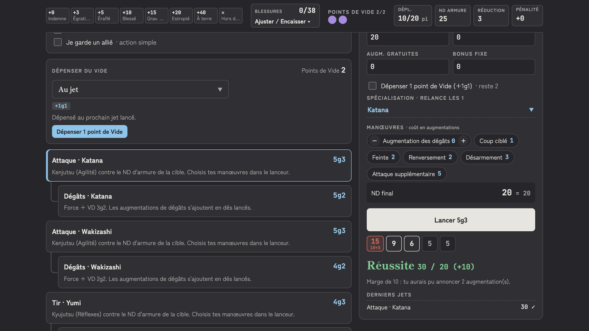
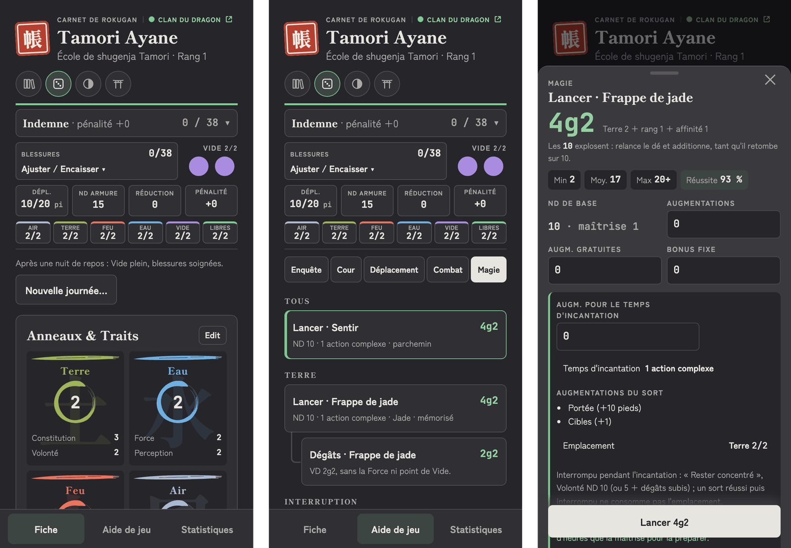

# Carnet de Rokugan

[](https://github.com/nelsio/carnet-l5r/actions/workflows/ci.yml)
[](https://github.com/nelsio/carnet-l5r/releases/latest)
[](LICENSE)

Compagnon de campagne pour les joueurs de **La Légende des Cinq Anneaux, 4e édition** : ta fiche de personnage, et les jets Roll & Keep prêts à lancer selon la situation.

**▶ [Ouvrir le Carnet](https://nelsio.github.io/carnet-l5r/)** · [Guide d'utilisation](docs/GUIDE.md) · [Nouveautés](https://github.com/nelsio/carnet-l5r/releases)



Un seul fichier HTML, **sans serveur ni compte** : rien n'est envoyé sur internet, tes fiches restent dans ton navigateur.

## Ce que fait le Carnet

- **Fiche complète** : anneaux, compétences, armes, armure, techniques d'école, sorts. Les réserves (`5g3`…) se recalculent à chaque changement.
- **Aide de jeu** par situation : Enquête, Cour, Déplacement, Combat (escarmouche, duel iaijutsu, bataille de masse) et Magie.
- **Lanceur** : il lance les dés pour toi, ou t'indique comment lancer tes vrais dés. Chance de réussite contre le ND, augmentations, manœuvres, Vide.
- **40 écoles** (bushi, courtisans, shugenja) et les maîtrises de compétence appliquées d'office.
- **Suivi en partie** : blessures, points de Vide, emplacements de sorts, nouvelle journée.
- **Sur téléphone** comme sur ordinateur, en thème clair ou sombre.





## Démarrer

1. Ouvre **https://nelsio.github.io/carnet-l5r/**.
2. Crée ta fiche : **Nouvelle fiche vierge**, un **modèle** (Bushi, Shugenja, Courtisan), ou un JSON exporté de la [Forge du portail](https://vincenzorpg.github.io/L5R/createcharacter.html).
3. Joue : onglet **Aide de jeu**, choisis la situation, touche une action.

Pour jouer **hors ligne**, **installe le Carnet** depuis ton navigateur (voir le [guide](docs/GUIDE.md#installer-sur-ton-téléphone-ou-ton-ordinateur)) ou télécharge `carnet-l5r.html` depuis la [dernière release](https://github.com/nelsio/carnet-l5r/releases/latest) et ouvre-le dans ton navigateur.

> **Pense à exporter ta fiche** (bloc **Fichier** → **Exporter la fiche**) : c'est ta sauvegarde, et le moyen de changer d'appareil ou de la partager avec le MJ. Sur Chrome et Edge, **Lier à un fichier** l'enregistre en continu, par exemple dans le dossier Drive de la campagne.

**MJ** : importe les fiches des joueurs en **Consultation**, en lecture seule. Détails dans le [guide](docs/GUIDE.md#11-pour-le-mj).

## En savoir plus

- [Guide d'utilisation](docs/GUIDE.md) : chaque écran et chaque règle appliquée, en détail.
- [Nouveautés](https://github.com/nelsio/carnet-l5r/releases) et [CHANGELOG](CHANGELOG.md).
- [Signaler un problème](https://github.com/nelsio/carnet-l5r/issues/new) : bug, règle à vérifier, idée.

Outil de fan **non officiel** et gratuit, sans lien avec les ayants droit de *Legend of the Five Rings*. Il ne reproduit aucun texte des livres : **ton livre de base fait foi**. Code sous licence [MIT](LICENSE) ; polices, marques et crédits : [CREDITS.md](docs/CREDITS.md).

---

## Développement

Spécification : [`HANDOFF.md`](HANDOFF.md). **Node 24** (voir `.nvmrc`).

```sh
npm install
npm run dev            # serveur de développement
npm run lint           # ESLint
npm run typecheck      # tsc --noEmit
npm test               # Vitest
npm run test:coverage  # Vitest + couverture (100 % des lignes de src/core)
npm run build          # dist/carnet-l5r.html, fichier unique autonome
npm run test:e2e       # Playwright, sur le build
```

**Publier une version** : mettre à jour `version` dans `package.json` (SemVer) et `CHANGELOG.md`, merger sur `main`, puis poser le tag (`git tag v1.2.3 && git push origin v1.2.3`). Le workflow `release.yml` vérifie que le tag correspond à `package.json`, relance les contrôles et publie la release avec `carnet-l5r.html`. Chaque merge sur `main` met aussi à jour la version en ligne (`pages.yml`).

**Contribuer** : voir [`CONTRIBUTING.md`](CONTRIBUTING.md) et le [code de conduite](CODE_OF_CONDUCT.md). Une faille de sécurité se signale en privé : [`SECURITY.md`](SECURITY.md).
