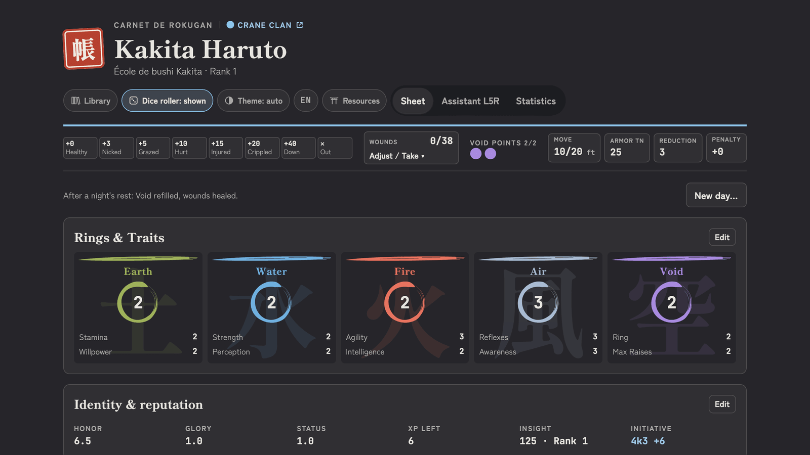
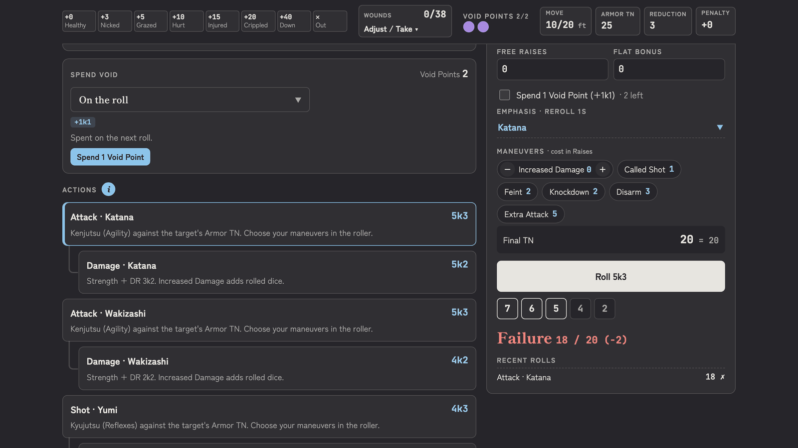
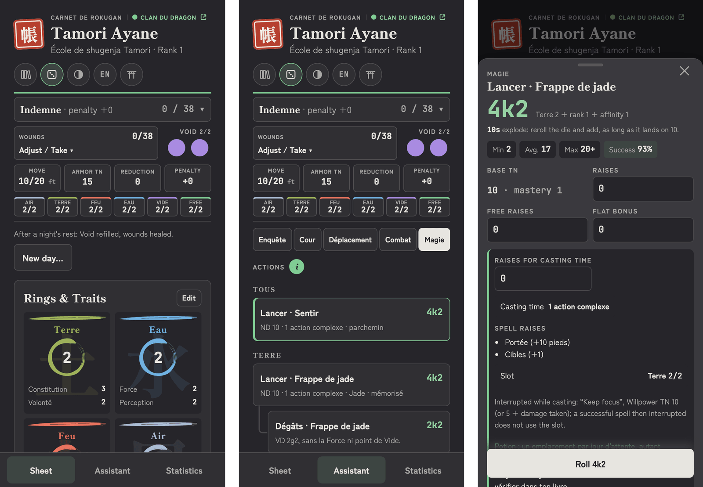

# Carnet de Rokugan

[](https://github.com/nelsio/carnet-l5r/actions/workflows/ci.yml)
[](https://github.com/nelsio/carnet-l5r/releases/latest)
[](LICENSE)

**English** · [Français](README-fr.md)

Campaign companion for **Legend of the Five Rings, 4th edition** players: free, no account needed. Your character sheet, plus a Roll & Keep assistant with rolls ready to throw for each situation, on desktop and mobile.

**▶ [Open the Carnet](https://nelsio.github.io/carnet-l5r/)** · [User guide](docs/GUIDE.md) (in French) · [What's new](https://github.com/nelsio/carnet-l5r/releases)



A single HTML file, **no server, no account**: your sheets stay in your browser and are never sent anywhere ([privacy](#privacy)).

## What the Carnet does

- **Full sheet**: rings, skills, weapons, armor, school techniques, spells. Dice pools (`5k3`…) are recalculated on every change.
- **Assistant L5R** by situation: Investigation, Court, Movement, Combat (skirmish, iaijutsu duel, mass battle) and Magic.
- **Dice roller**: it rolls for you, or tells you how to roll your real dice. Odds of success against the TN, Raises, maneuvers, Void.
- **40 schools** (bushi, courtiers, shugenja) and skill masteries applied automatically.
- **Import from a photo of a paper sheet**, with the AI of your choice: the Carnet gives you the prompt, you paste the answer and check it.
- **Tracking during play**: wounds, Void Points, spell slots, new day.
- **On phone** as on desktop, in light or dark theme.
- **In English or French**: interface, rules and schools follow your browser's language, with an **FR/EN** button in the header. Spells from the campaign portal's grimoire stay in French.





## Getting started

1. Open **https://nelsio.github.io/carnet-l5r/**.
2. Create your sheet: **New blank sheet**, a **template** (Bushi, Shugenja, Courtier), or a JSON exported from the [portal's Forge](https://vincenzorpg.github.io/L5R/createcharacter.html) (in French).
3. Play: **Assistant L5R** tab, pick the situation, tap an action.

To play **offline**, **install the Carnet** from your browser (see the [guide](docs/GUIDE.md#installer-sur-ton-téléphone-ou-ton-ordinateur), in French) or download `carnet-l5r.html` from the [latest release](https://github.com/nelsio/carnet-l5r/releases/latest) and open it in your browser.

> **Remember to export your sheet** (**File** block → **Export the sheet**): it is your backup, and the way to change devices or share it with the GM. On Chrome and Edge, **Link to a file…** saves it continuously, for example in your group's shared folder.

**GM**: import the players' sheets as **Read-only (GM)**. Details in the [guide](docs/GUIDE.md#11-pour-le-mj) (in French).

## Privacy

The web address counts visits with [GoatCounter](https://www.goatcounter.com), without cookies: each time the page opens, it receives the page address, the site you came from, your browser, your language and your screen size. Your IP address is used to infer your country and is not stored. **Your sheets and your characters' names are never sent.** The `carnet-l5r.html` file counts nothing.

## Learn more

- [User guide](docs/GUIDE.md) (in French): every screen and every rule applied, in detail.
- [What's new](https://github.com/nelsio/carnet-l5r/releases) and [CHANGELOG](CHANGELOG.md) (in French).
- [Report an issue](https://github.com/nelsio/carnet-l5r/issues/new): bug, rule to check, idea.

## Contact / Feedback

- **A bug?** Open a [GitHub issue](https://github.com/nelsio/carnet-l5r/issues/new): it is public, and others can follow it.
- **A question, an idea, some feedback?** Use **Contact** at the bottom of the Carnet: a private message to the author, sent by email through the [Web3Forms](https://web3forms.com) service. Leave an email address if you want a reply. Nothing is stored in the Carnet, and your sheets are never sent.

L5R is a trademark of its publisher; **unofficial**, free fan tool, not affiliated with the rights holders of *Legend of the Five Rings*. It reproduces no text from the books: **your core book is the authority**. Code under the [MIT](LICENSE) license; fonts, trademarks and credits: [CREDITS.md](docs/CREDITS.md).

---

## Development

Specification (in French): [`HANDOFF.md`](HANDOFF.md) (index), details in [`spec/`](spec/). **Node 24** (see `.nvmrc`).

```sh
npm install
npm run dev            # development server
npm run lint           # ESLint and specification reference check
npm run typecheck      # tsc --noEmit
npm test               # Vitest
npm run test:coverage  # Vitest + coverage (100% of lines in src/core)
npm run build          # dist/carnet-l5r.html, single self-contained file
npm run test:e2e       # Playwright, on the build
```

**Publishing a version**: update `version` in `package.json` (SemVer) and `CHANGELOG.md`, merge into `main`, then push the tag (`git tag v1.2.3 && git push origin v1.2.3`). The `release.yml` workflow checks that the tag matches `package.json`, reruns the checks and publishes the release with `carnet-l5r.html`. Every merge into `main` also updates the online version (`pages.yml`).

**Contributing**: see [`CONTRIBUTING.md`](CONTRIBUTING.md) and the [code of conduct](CODE_OF_CONDUCT.md) (in French). Report security vulnerabilities privately: [`SECURITY.md`](SECURITY.md) (in French).
