# Carnet de Rokugan guide

**English** · [Français](GUIDE.md)

[← Back to the README](../README-en.md)

Read this guide in order the first time, then come back to any section as needed. Each section starts with the essentials; rule details are folded under **“詳 · Going further”**, to open when you need them.

Each illustration carries numbered seals 一, 二, 三…: the list just below explains them in the same order.

> The rule summaries are **written for the tool**; **check them in your book**, which is the authority.

**天 · The threshold**

1. [The first step: the Carnet in 5 minutes](#1-the-carnet-in-5-minutes)
2. [The gates of the Carnet: opening it, online or offline](#2-opening-the-carnet-online-or-offline)
3. [The birth of a samurai: creating your sheet](#3-creating-your-sheet)

**地 · The way**

4. [The samurai's ledger: filling in and tracking your sheet](#4-filling-in-and-tracking-your-sheet)
5. [Knowing where you stand: the L5R Assistant](#5-the-l5r-assistant)
6. [The fall of the dice: the roller](#6-the-roller)
7. [The voice of the kami: shugenja, spells and magic](#7-shugenja-spells-and-magic)
8. [The legacy of the masters: schools, masteries and bonuses](#8-schools-masteries-and-bonuses)
9. [Counting the odds: statistics](#9-statistics)

**人 · The memory**

10. [Copying the scrolls: saving and changing devices](#10-saving-and-changing-devices)
11. [The GM's eye: for the GM](#11-for-the-gm)
12. [Tongues, portal and discretion: language, portal and privacy](#12-language-portal-and-privacy)

Licenses, fonts and credits: [CREDITS.md](CREDITS.md).

## 一 · The first step: the Carnet in 5 minutes

*“Six gestures are enough to enter the court. The rest comes with practice.”*

<picture>
  <source media="(prefers-color-scheme: dark)" srcset="img/guide/en/sombre/01-accueil.png">
  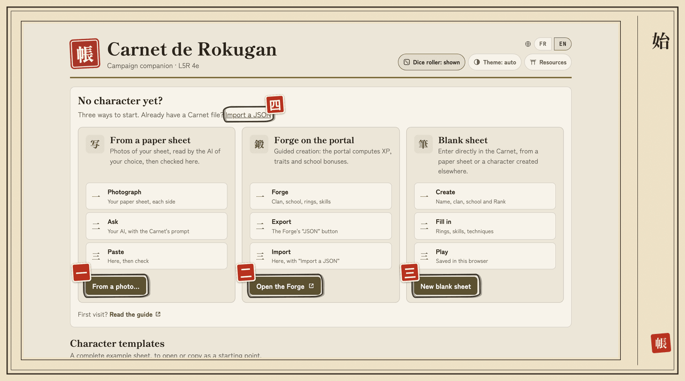
</picture>

- **一** (1) **From a photo…**: your paper sheet, read by the AI of your choice.
- **二** (2) **Open the Forge**: create your character on the portal, with XP calculation.
- **三** (3) **New blank sheet**: enter everything yourself.
- **四** (4) **Import a JSON**: bring back a sheet exported from the Carnet or the Forge.

1. **Open** https://nelsio.github.io/carnet-l5r/. Nothing to install, no account.
2. **Create your sheet** in the **Library**, in one of the four ways above, or from a **template** ([§ 3](#3-creating-your-sheet)).
3. **Fill it in**: each block's **Edit** button switches it to input, **Done** switches it back to reading ([§ 4](#4-filling-in-and-tracking-your-sheet)).
4. **Play**: **L5R Assistant** tab, pick the situation (Investigation, Court, Movement, Combat, Magic), tap an action ([§ 5](#5-the-l5r-assistant)).
5. **Roll**: the roller shows the pool (`5k2`) and your odds of success, then rolls the dice for you, or tells you how to roll your own ([§ 6](#6-the-roller)).
6. **Export your sheet** from time to time (**File** block → **Export the sheet**): it is your backup ([§ 10](#10-saving-and-changing-devices)).

Your sheet is **saved automatically** in your browser, on every change. It is **never sent anywhere**: nobody sees it until you export it.

## 二 · The gates of the Carnet: opening it, online or offline

*“A gate opened once stays open, even far from any road.”*

| Way | For whom | How |
|---|---|---|
| **Online** | Everyone | Open **https://nelsio.github.io/carnet-l5r/** |
| **Installed** | Playing without a network, on a phone | See below |
| **File** | Nothing to install, no network | Download `carnet-l5r.html` from the [latest release](https://github.com/nelsio/carnet-l5r/releases/latest) and double-click it |

### Install on your phone or computer

Open the Carnet's address once while online, then:

- **Chrome, Edge, Android**: browser menu → **Install app**;
- **iPhone, iPad (Safari)**: **Share** → **Add to Home Screen**.

The Carnet then opens **without a connection** and updates itself whenever a network is available.

詳 · Pitfalls to know

- On **iPhone and iPad**, the installed app keeps its sheets **separate from Safari**: export them from Safari, then import them into the app ([§ 10](#10-saving-and-changing-devices)).
- With the **file**, sheets belong **to that file, on that device**: to find them elsewhere, export them.
- On **Safari**, a file opened directly may not be allowed to store data: the tool switches to **degraded mode**. Use the online version, or another browser.
- If the browser refuses storage (strict private browsing, for example), a **banner** warns you: **export your sheet before closing**, or it will be lost.

## 三 · The birth of a samurai: creating your sheet

*“Every samurai begins as a name set down on paper.”*

The **Library** lists all your sheets. You get back to it with the **Library** button in the header, or with the red **帳 seal** to the left of the name. Four ways to start:

| Starting point | Button | Best if… |
|---|---|---|
| **Paper sheet** | **From a photo…** | your character already exists on paper |
| The portal's **Forge** | **Import a JSON…** | you are creating a character with XP calculation ([§ 12](#12-language-portal-and-privacy)) |
| **Template** | **Character templates** → **Use** | you want to try a ready-made Bushi (Kakita), Shugenja (Tamori) or Courtier (Doji) |
| **Blank sheet** | **New blank sheet** (or **New sheet**, below the list) | you prefer to enter everything yourself |

<picture>
  <source media="(prefers-color-scheme: dark)" srcset="img/guide/en/sombre/01b-modeles.png">
  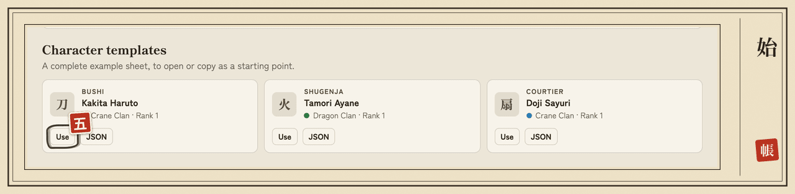
</picture>

- **五** (5) **Use**: creates a sheet from the template and opens it. **JSON**, right next to it, downloads the template's file.

### From a photo of a paper sheet

<picture>
  <source media="(prefers-color-scheme: dark)" srcset="img/guide/en/sombre/03-photo.png">
  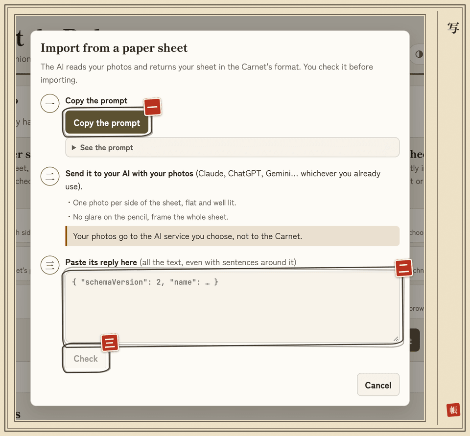
</picture>

- **一** (1) **Copy the prompt**: the text to send to your AI along with your photos.
- **二** (2) **AI reply**: paste its whole reply here, sentences around it included.
- **三** (3) **Check**: checks the reply and opens the import preview.

1. **From a photo…** (Library, or **File** block of an open sheet), then **Copy the prompt**.
2. Send this prompt, with a photo of each side of your sheet (flat, well lit, no glare), to the AI you already use (Claude, ChatGPT, Gemini…).
3. Paste its **whole** reply into the field, then **Check**.
4. Choose the destination, look at the preview, then **Import** or **Apply**.
5. Check the values in the **To check on your sheet** box: the AI had trouble reading them.

Your photos go to the AI service you choose, **not to the Carnet**: it only sees the text you paste. On an open sheet, the import **merges** by default: handy for catching up with a paper sheet kept up to date during a session.

詳 · Going further: templates

In the empty Library, **Character templates** offers three complete sheets: **Bushi** (Kakita Haruto), **Shugenja** (Tamori Ayane, with two spells) and **Courtier** (Doji Sayuri, with two roll bonuses). The interface offers the templates in its own language: in English, skills, spells and notes are written in English. **Use** creates a sheet from one in this browser and opens it; **JSON** downloads the file, to adapt and then import. Once you have sheets, the templates are below the list (“Or start from a template:”). The browser tab shows the name of the open character.

## 四 · The samurai's ledger: filling in and tracking your sheet

*“A samurai keeps his accounts as he keeps his sword: with care, every day.”*

<picture>
  <source media="(prefers-color-scheme: dark)" srcset="img/guide/en/sombre/04-fiche.png">
  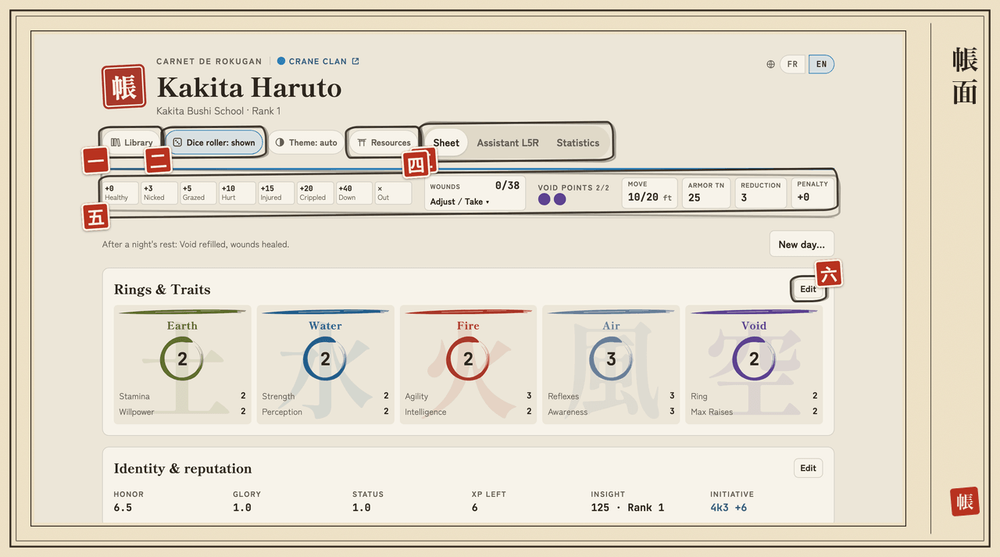
</picture>

- **一** (1) **Library**: find all your sheets.
- **二** (2) **Dice roller**: show or hide the roller, on the right of the screen.
- **三** (3) **Resources**: the Chroniques de Rokugan portal, this guide, what's new.
- **四** (4) **Sheet · L5R Assistant · Statistics**: the Carnet's three screens.
- **五** (5) **Status bar**: wounds, Void, movement, Armor TN. It follows you as you scroll.
- **六** (6) **Edit**: switches the block to input; **Done** closes it.

Your sheet saves itself on every change.

- **Edit** on a block switches it to input, **Done** switches it back to reading. Several blocks can be open at once.
- **Pools** (`5k3`, `6k2`…) are recalculated on every change, school techniques and masteries included ([§ 8](#8-schools-masteries-and-bonuses)).
- **New day…** (at the top of the sheet), after a night's rest: preview, then **Confirm new day**. Void Points back to the maximum, `2 × Stamina + Rank` wounds healed, spell slots recharged, initiative and skirmish counters reset.

<picture>
  <source media="(prefers-color-scheme: dark)" srcset="img/guide/en/sombre/04-edition.png">
  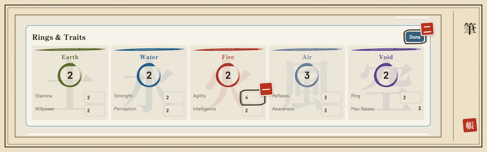
</picture>

- **一** (1) **Agility**: a trait changed; the Ring and every pool follow at once.
- **二** (2) **Done**: switches the block back to reading.

On a phone, the same sheet fits in one column:

<picture>
  <source media="(prefers-color-scheme: dark)" srcset="img/guide/en/sombre/04-fiche-mobile.png">
  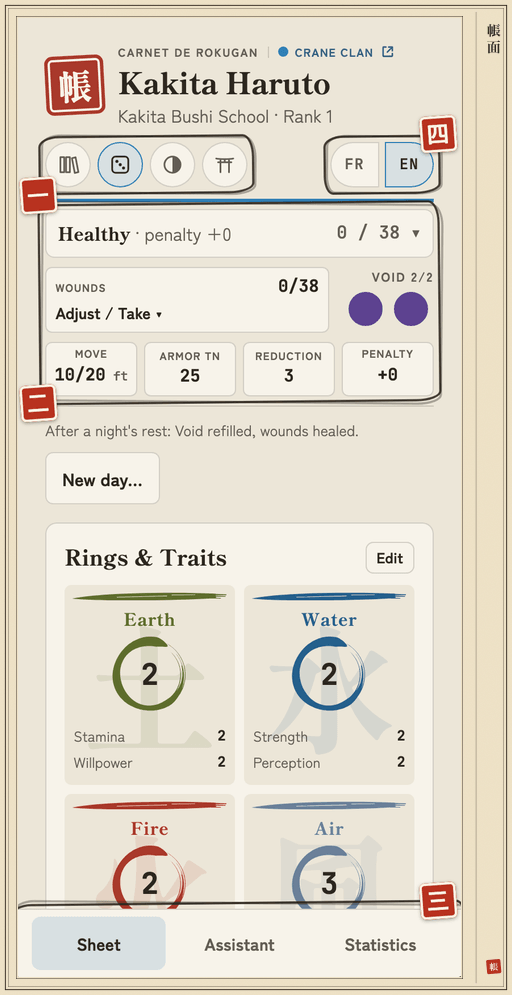
</picture>

- **一** (1) **Round header buttons**: Library, dice roller, theme, Resources; the **FR | EN** toggle closes the row.
- **二** (2) **Status bar**: the same as on desktop, more compact.
- **三** (3) **Sheet · Assistant · Statistics**: the tabs move to the bottom of the screen.

### The status bar

<picture>
  <source media="(prefers-color-scheme: dark)" srcset="img/guide/en/sombre/04-barre-etat.png">
  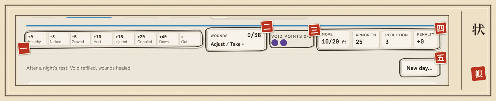
</picture>

- **一** (1) **Wound levels**: the track of the 8 levels and their penalty.
- **二** (2) **Wounds · Adjust / Take**: correct, heal or take a hit.
- **三** (3) **Void Points**: a tap spends or refunds a point.
- **四** (4) **Move · Armor TN · Reduction · Penalty**: your current values.
- **五** (5) **New day…**: after a night's rest.

| Tile | What it shows | A tap… |
|---|---|---|
| **Wounds** `2/38` | wounds taken / maximum, track of the 8 levels with their penalty | opens **Adjust** (`−` / `+`: corrections, healing) and **Attack damage** (Reduction and Void applied, **Take**) |
| **Void Points** | one pip per point | spends or refunds a point |
| **Move** `10/20 ft` | free action / simple action | — |
| **Armor TN**, **Reduction** | current values | opens the armor editor |
| **Penalty** | in red as soon as it is above `0` | — |
| **Spells** (shugenja) | spell slots left today, by element | opens the editor ([§ 7](#7-shugenja-spells-and-magic)) |

On mobile, a tap on the wound summary opens the details: one line per level, with its wound range. The levels follow the book: Healthy up to `Earth × 5`, then `Earth × 2` per level.

詳 · Going further: armor

The **Armor** block shows “book armor” or “custom armor”, the **Armor TN** in Attack stance (`5 × Reflexes 3 + 5 + armor 5 = 25`, plus the automatic bonuses of your techniques), the **Reduction** (armor and techniques) and the book armor's **special rule**. Its **Edit** button, like the **Armor TN** and **Reduction** tiles, opens the editor: name, TN bonus, Reduction.

The **Book armor** list fills in these three fields: none, ashigaru, light, heavy, riding. Effects:

- light armor: `+5` to the TN of Athletics and Stealth rolls;
- heavy armor: `+5` to the TN of Agility and Reflexes rolls (except the Hida school);
- riding armor: `+12` Armor TN when mounted, and counts as heavy on foot.

Changing the bonus or the Reduction afterwards makes it a **custom armor**, with no effect.

詳 · Going further: Insight, weapons, old skill names

- **Insight**: the **Identity & reputation** block computes your points (sum of the Rings × 10, plus the ranks of all your skills, emphases not included), shown as `125 · Rank 1`. Rank 1 below 150 points, then one rank every 25 points (Rank 2 at 150, Rank 3 at 175…), up to 10. **Insight bonus (GM)** adds points granted outside the calculation. The **Insight Rank you enter is the authority** for every calculation (initiative, healing, school rank…): if it differs from the calculation, a tag points it out (“Entered rank 3 · computed 1”), without blocking anything.
- **Weapons**: a book weapon entered with other values (DR, keywords) is flagged; **Update** restores the book's values.
- **Skill names**: a sheet can use the English names of the skills (Stealth, Courtier, Perform: Storytelling, Lore: History…) or the French ones: school techniques and masteries recognize both. A sheet still using old French labels (Furtivité, Courtoisie, Conteur, Éloquence, Politesse) works as is; a banner offers **Update…**: preview, then **Rename** (can be undone right away) or **Later**. English names are never renamed.

## 五 · Knowing where you stand: the L5R Assistant

*“Before drawing the blade, know where you stand.”*

The **L5R Assistant** tab (**Assistant** in the bottom bar on mobile) offers the rolls for each situation. Pick the situation, tap an action: the roller opens ([§ 6](#6-the-roller)).

<picture>
  <source media="(prefers-color-scheme: dark)" srcset="img/guide/en/sombre/05-assistant.png">
  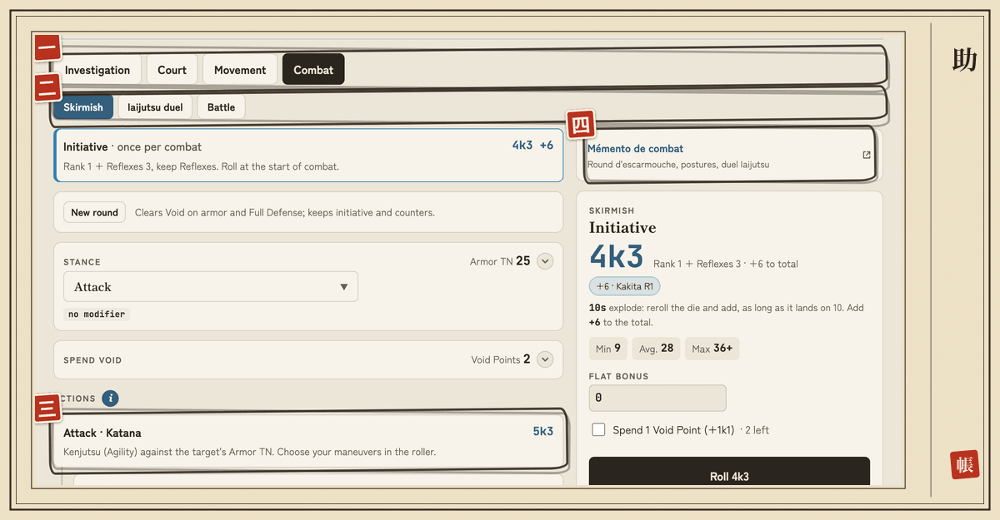
</picture>

- **一** (1) **Investigation · Court · Movement · Combat**: the current situation (and **Magic** for a shugenja).
- **二** (2) **Skirmish · Iaijutsu duel · Battle**: the type of combat.
- **三** (3) **Attack · Katana**: an action, with its pool; a tap opens the roller.
- **四** (4) **Mémento de combat**: the portal's play aid, in a new tab (in French).

| Situation | What you find there |
|---|---|
| **Investigation** | Notice a detail, search a place, question a witness, spot a lie, Courtier, Etiquette, **Recall** (one action per `Lore: …` skill), **Meditate** (under Rest) |
| **Court** | Courtier, Etiquette, Sincerity, Intimidation, Temptation, Acting, Commerce, **Perform** (one action per `Perform: …` skill) |
| **Movement** | Distances in combat (feet), Athletics, Horsemanship, Stealth, Hunting, forced march |
| **Combat** | **Skirmish**, **Iaijutsu duel**, **Battle** |
| **Magic** | Shugenja only ([§ 7](#7-shugenja-spells-and-magic)) |

**Meditate** (Meditation/Void TN 20): the **Success** button gives you back 1 Void Point, 2 with Meditation 3, 3 with Meditation 7.

An action your stance forbids is **greyed out** with the reason; **Roll anyway** is still possible. Once you know your actions by heart, the **“i”** next to the **Actions** title hides their explanations (setting remembered for all your sheets); the other **“i”** buttons hide the details of Void, movement, battle and school reminders. The **⌄** arrows of Stance and Spend Void are remembered the same way.

### Skirmish

<picture>
  <source media="(prefers-color-scheme: dark)" srcset="img/guide/en/sombre/05-escarmouche.png">
  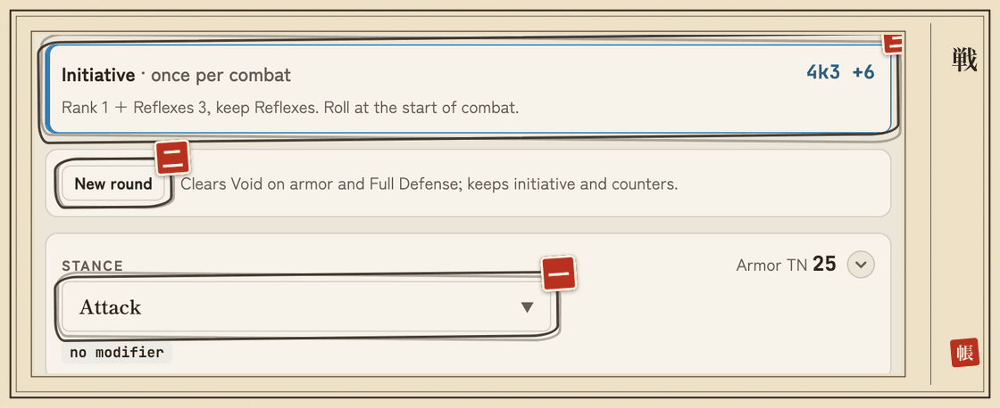
</picture>

- **一** (1) **Stance**: Attack, Full Attack, Defense, Full Defense or Center; the Armor TN follows.
- **二** (2) **New round**: clears Void on armor and Full Defense.
- **三** (3) **Initiative**: roll it once, at the start of combat.

From top to bottom, in the order of a round:

1. **Initiative**: roll it at the start of combat; your score is shown afterwards.
2. **New round**: clears Void on armor and Full Defense, **keeps initiative and counters**.
3. **Stance**: a menu with Attack, Full Attack…; the modifiers of the chosen stance are shown below it and the **Armor TN** follows. The **⌄** arrow shows the description, **Mounted** and **I guard an ally**; a ticked box stays visible in the header when the panel is folded.
4. **Spend Void**: folded by default, it shows your points and the spending in progress; the **⌄** arrow opens it. Choose the spending, then **Spend 1 Void Point**; **Cancel** refunds the point.
5. **Attacks** for each weapon, with their **damage** right below (`└`). A shugenja sees their **spells** right after Initiative.

To **take** a hit: **Wounds** tile → **Attack damage**.

詳 · Going further: stances, Void, Center, Feint

- **Initiative**: `+10` in the round after Center, `+10` per Void Point spent for the skirmish.
- **Forbidden by stance**: no attack in Defense, no ranged attack in Full Attack, nothing but Initiative in Center; no mounted Full Attack without Horsemanship 3. A shugenja casts no spells in **Full Attack** or **Full Defense**.
- **I guard an ally**: your Armor TN `−5`, theirs `+10`.
- **Void spending**: `+1k1` on the roll, `+10` Armor TN, skill used at rank 1, ability paid with Void, `+10` Initiative or Initiative swap. Choosing spends nothing.
- **Center bonus**: in the round after Center, the roller offers it (`+1k1` and your Void Ring to the total, on a single roll); it also applies to a spell roll.
- A successful **Feint**: its bonus is pre-filled on the damage.
- **Take** subtracts your Reduction (and `10` with a Void Point), then adds the wounds.

### Iaijutsu duel

The **Assessment → Focus → Strike** steps replace initiative and stance (Center implied). Tick an Assessment **won by 10 or more**, enter the **Focus margin**: the Free Raises carry over to the Strike.

### Mass battle

No initiative; the panel follows one battle turn:

1. **Army status**: **Winning**, **Stalemate** or **Losing**, as the GM says. If you command, tick **I command the army** and enter the margin of your Command roll (Battle/Perception) over the enemy commander (a margin of `5` to win or lose).
2. **Engagement**: Reserves, Disengaged, Engaged or Heavily Engaged.
3. **Battle roll**: `1d10` (no explosion) `+ Water + Battle`; enter your total, or **Roll 1d10**. **Tactician** adds `+5` or `−5`.
4. **Result**: the cell of the book's table (“2 wound dice, 1 Glory, Duel”). Roll those dice (no explosion, added up), then **Take**: your Reduction applies.

**New round** clears the roll and keeps your engagement.

## 六 · The fall of the dice: the roller

*“The dice fall where they will; the samurai already knows what he risks.”*

Choosing an action opens the **roller** (a panel that slides up from the bottom on mobile).

<picture>
  <source media="(prefers-color-scheme: dark)" srcset="img/guide/en/sombre/06-lanceur.png">
  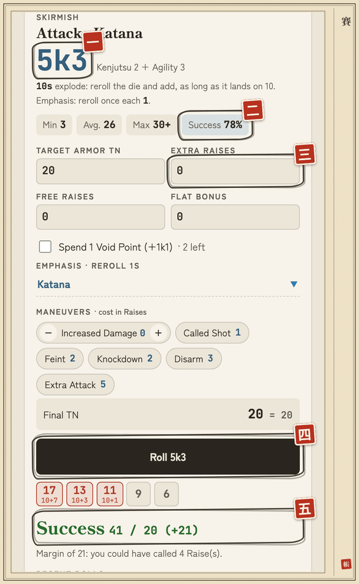
</picture>

- **一** (1) **Pool**: `5k3` = roll 5 dice, keep 3.
- **二** (2) **Success**: your odds of success against the final TN.
- **三** (3) **Extra Raises**: the Raises you call, `+5` to the TN each.
- **四** (4) **Roll**: the tool rolls the dice for you.
- **五** (5) **Result**: the kept dice, the total against the TN and the margin.

The roller also gives **Min · Avg. · Max**, Free Raises, the flat bonus, the Void Point, the **emphasis** (it rerolls `1`s), attack maneuvers, and the **“roll by hand”** line: the reroll rules for **playing with your own dice** (“10s explode…”, bonus to add to the total). Raises are limited by your Void Ring.

**The tool's dice or real dice?** By default, the tool rolls the dice: **Roll** button, result and history. To play with your own dice, press **Dice roller** in the header (the die icon on mobile) to hide it. The choice is remembered.

> With the dice roller shown, a successful attack with **Increased Damage** pre-fills the extra dice on the damage roll (tag “+2k0 · attack Raises”, which **Remove** cancels).

## 七 · The voice of the kami: shugenja, spells and magic

*“The kami listen to those who know what they ask.”*

Everything about magic, from noting spells to casting them. The section appears for a **shugenja school** ([§ 8](#8-schools-masteries-and-bonuses)) or as soon as a spell is noted.

<picture>
  <source media="(prefers-color-scheme: dark)" srcset="img/guide/en/sombre/07-magie-mobile.png">
  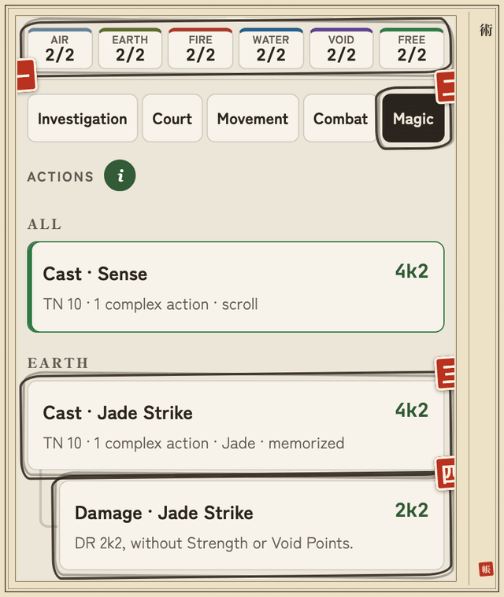
</picture>

- **一** (1) **Spells**: your spell slots left today, by element.
- **二** (2) **Magic**: the situation that gathers your spells.
- **三** (3) **Cast · Jade Strike**: a spell, with its pool, its TN and its casting time.
- **四** (4) **Damage · Jade Strike**: the damage roll, for a spell that has a DR.

### Noting your spells

<picture>
  <source media="(prefers-color-scheme: dark)" srcset="img/guide/en/sombre/07-sorts.png">
  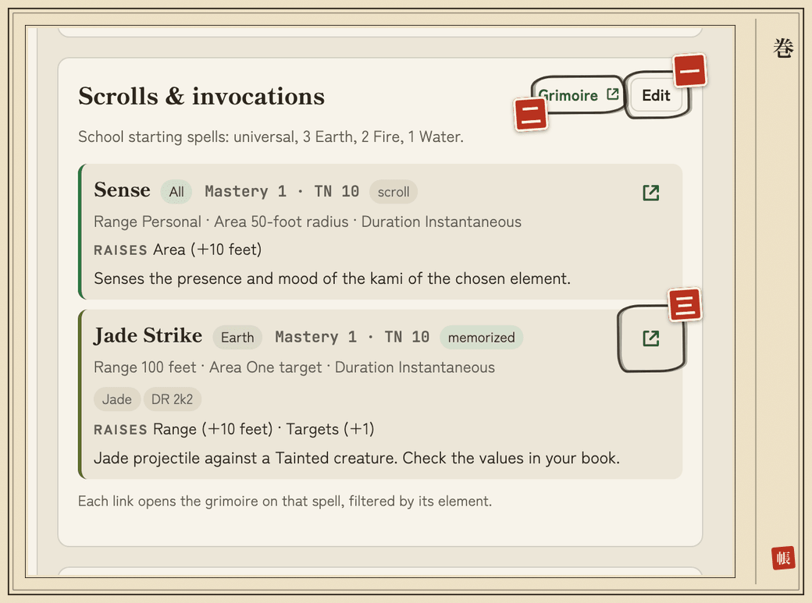
</picture>

- **一** (1) **Edit**: switches the block to input, with **+ Spell** and **Add from the grimoire**.
- **二** (2) **Grimoire**: the portal's grimoire, in a new tab (in French).
- **三** (3) **Spell icon**: opens the grimoire on this spell, filtered by its element.

The **Scrolls & invocations** section (after School techniques) shows one card per spell, sorted by element then mastery, with the school's **starting spells** as a reminder at the top. The Carnet contains **no spell catalog**: you add spells in two ways, in **Edit**.

- **From the grimoire** (the fastest): **Add from the grimoire** → **Load the grimoire** the first time (about 110 KB, then kept in this browser, even offline). Search by name (French or English), filter by element, **+ Add** (or Enter). Then fill in the **effect**, the **Memorized** box and often the **DR**, which the grimoire does not give yet. The grimoire's spells are in French.
- **By hand**: **+ Spell**, and copy the spell from your book in your own words. **Add the universal spells** adds Sense, Commune and Summon (element “All”).

**Autocomplete**: with the grimoire loaded, type at least two letters in a spell's **Name** field; ↑ ↓ to choose, Enter or click to fill in.

詳 · Going further: grimoire and autocomplete

- A spell already noted is marked “already noted”. **Refresh**, to the right of the buttons, reloads the grimoire. Nothing is sent. With the grimoire loaded, **Add the universal spells** fills them in too. Without a connection, everything still works by hand.
- An added spell arrives at the end of the list with its name, element, mastery, range, area, duration, keywords and Raises.
- Autocomplete suggests up to eight spells; Escape closes the list, ↓ opens it on a name already typed. It replaces the name, element and mastery, then range, area, duration, keywords, Raises and DR (if the grimoire gives it). The effect and **Memorized** never change.
- If you had already entered other values, the Carnet shows them first: **Replace**, **Fill the blanks** (keeps your values) or **Cancel** (nothing changes, your name included). A name missing from the grimoire is accepted as is.
- With no grimoire loaded, the **load the grimoire** line under the name loads it without opening the panel.
- A spell's card: element, `Mastery 2 · TN 15`, **memorized** or **scroll**, range, area, duration, keywords, DR, Raises and effect.

### Today's slots

The **Spells** line of the status bar shows your remaining slots, `left/max`, in **Air, Earth, Fire, Water, Void** (one per Ring point) and **Free** (as many as your Void Ring, for any element). A tap opens the editor (`−` spends, `+` refunds). **New day…** recharges them.

### Casting a spell

**L5R Assistant** tab → **Magic**: one **Cast** card per spell, grouped by element, with the pool `(Ring + school rank ±1) k Ring`, the TN (`5 + 5 × mastery`) and the casting time. **Damage** appears if the spell has a DR (without Strength or Void Points). In a Skirmish, your spells are in the **Spells** group.

- The roller's **Slot** line tells you which slot the spell will use: `Fire 2/3`, `free 1/2` if the element is used up, or **no slot** in red.
- A cast, successful or failed, **spends the slot**: **Roll** button, or **Success** / **Failed** with your own dice. A spell that succeeds and is then **interrupted** does not use it: **Cancel (interrupted)** refunds it.
- A spell your rank does not allow (mastery too high, deficiency element at rank 1) is greyed out with the reason; **Roll anyway** is still possible.
- **Stay focused** (at the end of the list): Willpower roll, TN 10, or 5 + the damage taken that you enter, after an interruption.

詳 · Going further: what the roller shows for a spell

- Where the pool comes from (“Earth 3 + rank 1 + affinity 1”) and the TN set by the mastery.
- Below the Raises: the element to choose for a **universal spell**, your **school boxes** (non-human target, it is daytime…), its **Free Raises** applied automatically (Jade keyword, Isawa's affinity element), **Raises for casting time**, the spell's Raises, and the reminders (scroll if the spell is not memorized, Willpower roll if you are interrupted, effect).
- The **Agasha** school can cast with another Ring: the Void Point is spent when rolling.
- The **Spellcraft 5** mastery adds `+1k0` to spell rolls.
- **Affinity and deficiency**: the School techniques block shows them (“Affinity Earth · Deficiency Air”); the casting rank gains `+1` in the affinity element and loses `1` in the deficiency element. The **Isawa** school lets you choose its affinity (Void included) in **Affinity (shugenja)** in the Identity block. Each school has its technique at rank 1; later ranks bring new spells.

## 八 · The legacy of the masters: schools, masteries and bonuses

*“The school shapes the hand; the hand does not forget.”*

Choose your school and the Carnet applies the rest: techniques, masteries and bonuses count **on their own** in the pools of the sheet, the Assistant and the statistics.

- **School**: in **Edit**, Identity block → **School techniques**. **School (displayed name)** takes the book's name, which you can change afterwards. **School Rank** equals your Insight Rank, unless you change it; the header shows “Kakita Bushi School · Rank 1”.
- **Skill masteries**: applied according to the rank of **each skill**, whatever your school. In the roller, they carry the **Mastery** badge (“`+1k0` · Kenjutsu 3”).
- **Roll bonuses**: for an advantage, a disadvantage or a technique outside the catalog (kata…), the sheet's **Roll bonuses** panel (in **Edit**).

What depends on the situation **is ticked**: in the roller (**Techniques to tick**) or in the **Stance** panel. What has no numeric effect appears in **School reminders**, in Combat as at Court.

詳 · Going further: the 40 schools

- **14 bushi schools**: Hida, Hiruma, Kakita, Daidoji, Mirumoto, Togashi, Akodo, Matsu, Yoritomo, Tsuruchi, Shiba, Bayushi, Moto, Utaku;
- **10 courtier schools**: Yasuki, Doji, Kitsuki, Ikoma, Yoritomo, Asako, Bayushi, Ide, Otomo, Miya;
- **2 Shosuro schools**: Infiltrator and Actor;
- **14 shugenja schools**: Kuni, Asahina, Tamori, Kitsu, Moshi, Isawa, Agasha, Soshi, Iuchi, Seppun, and in the **Minor Clans** group Komori (Bat), Tonbo (Dragonfly), Kitsune (Fox), Chuda.

詳 · Going further: how techniques apply

- The techniques of your rank count in the pools, with the Attack stance as reference.
- **Situational** techniques are ticked in the roller or in the **Stance** panel (Armor TN boxes, hit counters, **Mounted** box).
- Techniques that act **on others** are shown as reminders with their value, on the sheet and below the pool of social rolls (“`+10` to the TN of whoever lies to you”).
- Some depend on the **emphasis** chosen in the roller: Deceit or Honesty for Ide, Control for Yoritomo, Deceit for Shosuro Actor.
- Weapons have **keywords** (Samurai, Heavy, Small, Bow…), pre-filled for known weapons: they decide which techniques apply.
- A sheet from an earlier version offers to **link** the school recognized in its name (“Link to Kakita Bushi School?”): **nothing changes without your confirmation**.

詳 · Going further: mastery examples

Kenjutsu 3 gives `+1k0` to sword damage and Kenjutsu 7 makes it explode on 9; Defense 5 adds `+3` to Armor TN in Defense; Battle 5 adds its rank to Initiative; Athletics 3 and 5 remove the terrain penalty; any skill at rank 10 gains a Free Raise. Those that depend on the situation (Polearms) are ticked, those with no numeric effect join the **reminders**.

詳 · Going further: entering a roll bonus

- By hand, from a **Bonus template** sorted by source: **advantage** (extra dice, Free Raise, reduced wound penalty…), **disadvantage** (dice penalty, higher TN…), **technique** (extra dice on attacks, on damage, in a stance…) or **free bonus**; you write the name of your advantage or technique.
- Or in your sheet's JSON (field `modifiers`): see the sheet templates in the Library.

An **“always”** bonus counts in every pool; an **“optional”** bonus is ticked in the roller when its condition is met.

## 九 · Counting the odds: statistics

*“Know your odds before you test them.”*

The **Statistics** page, next to **Sheet** and **L5R Assistant** (in the bottom bar on mobile), gives for **all your rolls** the pool, the minimum, the average, the maximum and the **odds of success** against a TN from `10` to `40`.

<picture>
  <source media="(prefers-color-scheme: dark)" srcset="img/guide/en/sombre/09-stats.png">
  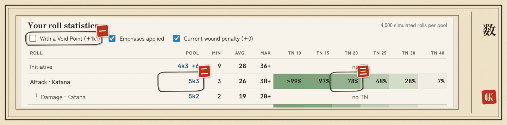
</picture>

- **一** (1) **With a Void Point (+1k1)**: recalculates the whole table with a Void Point spent.
- **二** (2) **Pool**: `5k3` for Attack · Katana.
- **三** (3) **TN 20**: a 78% chance of succeeding against a TN of 20.

- Three boxes: **With a Void Point (+1k1)**, **Emphases applied**, **Current wound penalty**.
- A shugenja also finds one line per spell (`Spell · Jade Strike (Earth)`), and its damage.
- Each Raise adds `+5` to the TN: shift one column to the right.

## 十 · Copying the scrolls: saving and changing devices

*“What is written only once can be lost. Copy your scrolls.”*

<picture>
  <source media="(prefers-color-scheme: dark)" srcset="img/guide/en/sombre/10-fichier.png">
  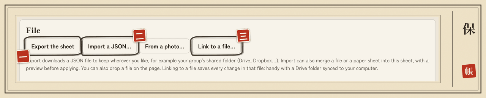
</picture>

- **一** (1) **Export the sheet**: downloads your sheet as JSON, your backup.
- **二** (2) **Import a JSON…**: merges a file into this sheet, after a preview.
- **三** (3) **Link to a file…**: saves every change in a file of your choice (Chrome and Edge on desktop).

| Need | How |
|---|---|
| **Back up** | **File** block → **Export the sheet**: a JSON file (`kakita-haruto-l5r.json`), to keep wherever you like, for example in your **group's shared folder** |
| **Back up continuously** (Chrome and Edge on desktop) | **Link to a file…**: every change is written to the chosen file, for example in a synced Drive folder |
| **Change devices** | export on the old one, then on the new one: Library → **Import a JSON…** → destination **New sheet** |
| **Update a sheet** | **Import a JSON…** into the open sheet: it **merges**, after a **preview** of the changes, additions and warnings. **Nothing is ever removed** by a merge |

詳 · Going further: linked file

- After a reload, the browser asks for permission again: click **Resume saving to…**.
- If the file was changed elsewhere, the tool lets you choose: **Load the file's version**, **Overwrite with my version**, or **Merge** after a preview.
- **Unlink** removes the link without touching the file.

## 十一 · The GM's eye: for the GM

*“The one who judges reads the scrolls without setting brush to them.”*

Import the players' JSON files as **Read-only (GM)** (Library → **Import a JSON…**, or **drop the file on the page**):

- the sheet is **read-only**: nothing in it can be changed;
- the roll assistant still works, **spending nothing** (Void Points);
- **Make editable** creates a **copy** of it, if needed.

To update a player's sheet, **import their new file**.

## 十二 · Tongues, portal and discretion: language, portal and privacy

*“Every voice has its tongue; what is entrusted stays at home.”*

### Language

<picture>
  <source media="(prefers-color-scheme: dark)" srcset="img/guide/en/sombre/12-en-tete.png">
  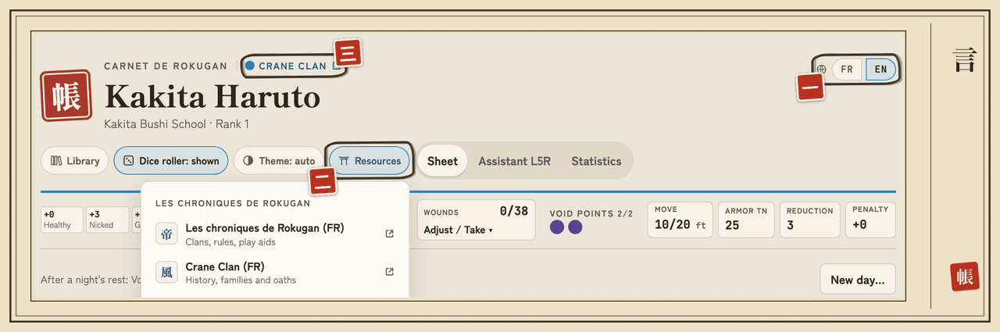
</picture>

- **一** (1) **FR | EN**: the language toggle, French or English.
- **二** (2) **Resources**: the button; its menu opens the portal, this guide and what's new, each in a new tab.
- **三** (3) **Crane Clan**: your clan's page on the portal (in French).

The Carnet opens in your browser's language, French or English. The **FR | EN** toggle, at the top right of the header (at the end of the button row on a phone), changes the language; the choice is remembered. **Your sheets are never translated**: what you entered stays as is.

詳 · Going further: the Carnet in English

In English, pools are written `5k3`, distances are in feet, and the rules (rings, wounds, stances, actions, explanations), the 40 schools, their techniques, the masteries and the sheet templates are in English. The grimoire and the portal's pages stay in French; the **Resources** menu marks them **(FR)**. A sheet entered with the English skill names (Stealth, Courtier, Lore: History…) works like a French sheet: school techniques and masteries recognize it.

### Les Chroniques de Rokugan

An independent fan site, in French (catalogs, character Forge, grimoire), usable by any group; it is not necessarily your GM's site. The **Forge** is a guided creation: it computes XP, traits and school bonuses, and exports a JSON to import here with **Import a JSON**.

The **Resources** button (torii icon, at the top) opens the links to this portal, each in a **new tab**. The Carnet never contacts this site on its own and always works offline; the only exception, when you ask for it: **Load the grimoire**.

詳 · Going further: all the links

- **Resources** menu: the home page, your clan's page (if a sheet is open), the **Character Forge**, the **Grimoire**, the **Combat memento**, **Bushido & honor** and **Etiquette & customs**.
- Elsewhere: the **clan name**, above the character's name, opens the clan page; in **Scrolls & invocations**, **Grimoire** opens the grimoire and each spell's icon looks it up by name and element; in the **L5R Assistant**, a box offers the **Mémento de combat** in Combat, **Étiquette & coutumes** and **Bushido & honneur** at Court (portal page titles, in French).
- The menu ends with the **The Carnet** section, with the version number: this **User guide**, **What's new**, **Report a problem** (GitHub account required) and the **Project page**. These links are also in the **footer**, with **Contact** (private message to the author). The empty Library offers **Read the guide** from the first visit. In English, the guide link leads to this English guide.

### Privacy

Your sheets and your characters' names **never leave your device**. The web address counts visits with [GoatCounter](https://www.goatcounter.com), without cookies: each time the page opens, it receives the page address, the site you came from, your browser, your language and your screen size. Your IP address is used to infer your country and is not stored. If an ad blocker stops it, the Carnet works exactly the same, and the `carnet-l5r.html` file counts nothing.
