# Guide du Carnet de Rokugan

**Français** · [English](GUIDE-en.md)

[← Retour au README](../README.md)

Ce guide se lit dans l'ordre la première fois, puis se consulte par section. Chaque section commence par l'essentiel ; le détail des règles est replié sous **« 詳 · Pour aller plus loin »**, à ouvrir au besoin.

Chaque illustration porte des sceaux numérotés 一, 二, 三… : la liste juste en dessous les explique dans le même ordre.

> Les résumés de règles sont **écrits pour l'outil** et restent **à vérifier dans ton livre**, qui fait foi.

**天 · Le seuil**
1. [Le premier pas : le Carnet en 5 minutes](#1-le-carnet-en-5-minutes)
2. [Les portes du Carnet : l'ouvrir, en ligne ou hors ligne](#2-ouvrir-le-carnet-en-ligne-ou-hors-ligne)
3. [La naissance d'un samouraï : créer ta fiche](#3-créer-ta-fiche)

**地 · La voie**

4. [Le registre du samouraï : remplir et suivre ta fiche](#4-remplir-et-suivre-ta-fiche)
5. [Savoir où l'on se tient : l'Assistant L5R](#5-lassistant-l5r)
6. [La chute des dés : le lanceur](#6-le-lanceur)
7. [La parole des kami : shugenja, sorts et magie](#7-shugenja--sorts-et-magie)
8. [L'héritage des maîtres : écoles, maîtrises et bonus](#8-écoles-maîtrises-et-bonus)
9. [Le compte des chances : statistiques](#9-statistiques)

**人 · La mémoire**

10. [La copie des rouleaux : sauvegarder et changer d'appareil](#10-sauvegarder-et-changer-dappareil)
11. [Le regard du MJ : pour le MJ](#11-pour-le-mj)
12. [Langues, portail et discrétion : langue, portail et confidentialité](#12-langue-portail-et-confidentialité)

Licences, polices et crédits : [CREDITS.md](CREDITS.md).

## 一 · Le premier pas : le Carnet en 5 minutes

*« Six gestes suffisent pour entrer dans la cour. Le reste viendra avec la pratique. »*

<picture>
  <source media="(prefers-color-scheme: dark)" srcset="img/guide/sombre/01-accueil.png">
  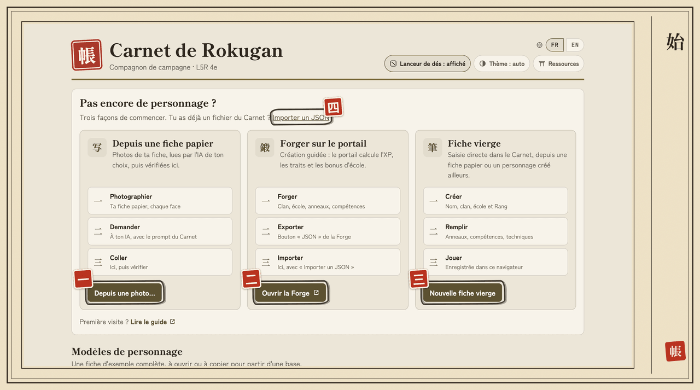
</picture>

- **一** (1) **Depuis une photo…** : ta fiche papier, lue par l'IA de ton choix.
- **二** (2) **Ouvrir la Forge** : créer ton personnage sur le portail, avec le calcul de l'XP.
- **三** (3) **Nouvelle fiche vierge** : tout saisir toi-même.
- **四** (4) **Importer un JSON** : reprendre une fiche exportée du Carnet ou de la Forge.

1. **Ouvre** https://nelsio.github.io/carnet-l5r/. Rien à installer, pas de compte.
2. **Crée ta fiche** dans la **Bibliothèque**, de l'une des quatre façons ci-dessus, ou depuis un **modèle** ([§ 3](#3-créer-ta-fiche)).
3. **Remplis-la** : le bouton **Edit** de chaque bloc passe en saisie, **Terminer** repasse en lecture ([§ 4](#4-remplir-et-suivre-ta-fiche)).
4. **Joue** : onglet **Assistant L5R**, choisis la situation (Enquête, Cour, Déplacement, Combat, Magie), touche une action ([§ 5](#5-lassistant-l5r)).
5. **Lance** : le lanceur affiche la réserve (`5g2`), ta chance de réussite, et lance les dés pour toi, ou te dit comment lancer les tiens ([§ 6](#6-le-lanceur)).
6. **Exporte ta fiche** de temps en temps (bloc **Fichier** → **Exporter la fiche**) : c'est ta sauvegarde ([§ 10](#10-sauvegarder-et-changer-dappareil)).

Ta fiche est **enregistrée automatiquement** dans ton navigateur, à chaque modification. Elle n'est **jamais envoyée** : personne ne la voit tant que tu ne l'exportes pas.

## 二 · Les portes du Carnet : l'ouvrir, en ligne ou hors ligne

*« Une porte ouverte une fois le reste, même loin de toute route. »*

| Façon | Pour qui | Comment |
|---|---|---|
| **En ligne** | Tout le monde | Ouvre **https://nelsio.github.io/carnet-l5r/** |
| **Installé** | Jouer sans réseau, sur téléphone | Voir ci-dessous |
| **Fichier** | Sans rien installer, sans réseau | Télécharge `carnet-l5r.html` depuis la [dernière release](https://github.com/nelsio/carnet-l5r/releases/latest), ouvre-le d'un double-clic |

### Installer sur ton téléphone ou ton ordinateur

Ouvre l'adresse du Carnet une première fois avec du réseau, puis :

- **Chrome, Edge, Android** : menu du navigateur → **Installer l'application** ;
- **iPhone, iPad (Safari)** : **Partager** → **Sur l'écran d'accueil**.

Le Carnet s'ouvre ensuite **sans connexion** et se met à jour tout seul dès qu'il y a du réseau.

詳 · Pièges à connaître

- Sur **iPhone et iPad**, l'application installée garde ses fiches **à part de Safari** : exporte-les depuis Safari, puis importe-les dans l'application ([§ 10](#10-sauvegarder-et-changer-dappareil)).
- Avec le **fichier**, les fiches restent **propres à ce fichier, sur cet appareil** : pour les retrouver ailleurs, exporte-les.
- Sur **Safari**, un fichier ouvert directement peut ne pas avoir le droit de stocker des données : l'outil passe en **mode dégradé**. Utilise la version en ligne, ou un autre navigateur.
- Si le navigateur refuse le stockage (navigation privée stricte, par exemple), une **bannière** te prévient : **exporte ta fiche avant de fermer**, sinon elle sera perdue.

## 三 · La naissance d'un samouraï : créer ta fiche

*« Tout samouraï commence par un nom posé sur le papier. »*

La **Bibliothèque** liste toutes tes fiches. On y revient par le bouton **Bibliothèque** de l'en-tête, ou par le **sceau 帳** rouge à gauche du nom. Quatre façons de commencer :

| Point de départ | Bouton | Idéal si… |
|---|---|---|
| **Fiche papier** | **Depuis une photo…** | ton personnage existe déjà sur papier |
| **Forge** du portail | **Importer un JSON…** | tu crées un personnage avec calcul de l'XP ([§ 12](#12-langue-portail-et-confidentialité)) |
| **Modèle** | **Modèles de personnage** → **Utiliser** | tu veux essayer avec un Bushi (Kakita), un Shugenja (Tamori) ou un Courtisan (Doji) déjà remplis |
| **Fiche vierge** | **Nouvelle fiche vierge** (ou **Nouvelle fiche**, sous la liste) | tu préfères tout saisir toi-même |

<picture>
  <source media="(prefers-color-scheme: dark)" srcset="img/guide/sombre/01b-modeles.png">
  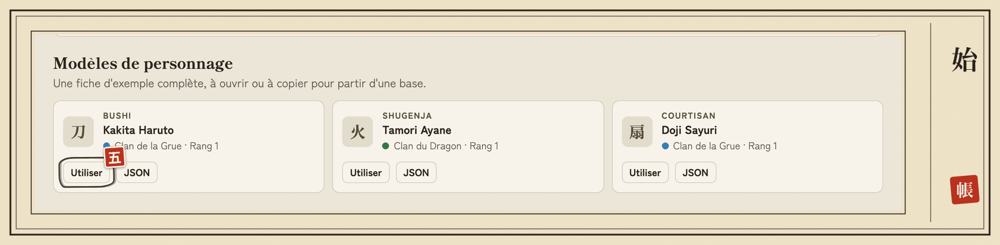
</picture>

- **五** (5) **Utiliser** : crée une fiche à partir du modèle et l'ouvre. **JSON**, juste à côté, télécharge le fichier du modèle.

### Depuis une photo de fiche papier

<picture>
  <source media="(prefers-color-scheme: dark)" srcset="img/guide/sombre/03-photo.png">
  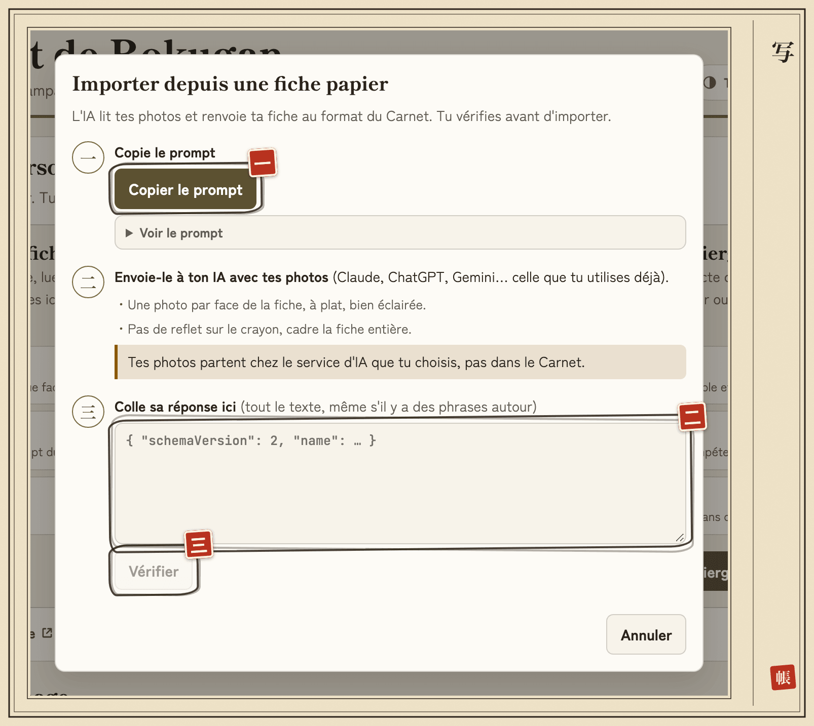
</picture>

- **一** (1) **Copier le prompt** : le texte à envoyer à ton IA avec tes photos.
- **二** (2) **Réponse de l'IA** : colle ici toute sa réponse, phrases autour comprises.
- **三** (3) **Vérifier** : contrôle la réponse et ouvre l'aperçu de l'import.

1. **Depuis une photo…** (Bibliothèque, ou bloc **Fichier** d'une fiche ouverte), puis **Copier le prompt**.
2. Envoie ce prompt, avec une photo de chaque face de ta fiche (à plat, bien éclairée, sans reflet), à l'IA que tu utilises déjà (Claude, ChatGPT, Gemini…).
3. Colle **toute** sa réponse dans le champ, puis **Vérifier**.
4. Choisis la destination, regarde l'aperçu, puis **Importer** ou **Appliquer**.
5. Contrôle les valeurs de l'encadré **À vérifier sur ta fiche** : l'IA a eu du mal à les lire.

Tes photos partent chez le service d'IA que tu choisis, **pas dans le Carnet** : il ne voit que le texte que tu colles. Sur une fiche ouverte, l'import **fusionne** par défaut : pratique pour rattraper une fiche papier tenue à jour en séance.

詳 · Pour aller plus loin : modèles

Dans la Bibliothèque vide, **Modèles de personnage** propose trois fiches complètes : **Bushi** (Kakita), **Shugenja** (Tamori, avec deux sorts) et **Courtisan** (Doji, avec deux bonus de jet). **Utiliser** en crée une fiche dans ce navigateur et l'ouvre ; **JSON** télécharge le fichier, à adapter puis importer. Quand tu as déjà des fiches, les modèles sont sous la liste (« Ou partir d'un modèle »). L'onglet du navigateur affiche le nom du personnage ouvert.

## 四 · Le registre du samouraï : remplir et suivre ta fiche

*« Un samouraï tient ses comptes comme il tient son sabre : avec soin, chaque jour. »*

<picture>
  <source media="(prefers-color-scheme: dark)" srcset="img/guide/sombre/04-fiche.png">
  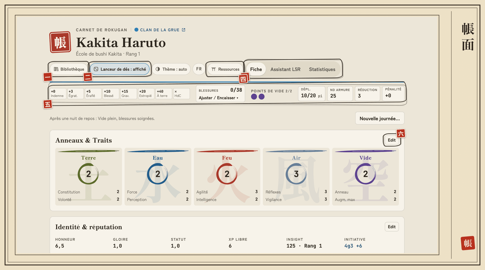
</picture>

- **一** (1) **Bibliothèque** : retrouver toutes tes fiches.
- **二** (2) **Lanceur de dés** : afficher ou masquer le lanceur, à droite de l'écran.
- **三** (3) **Ressources** : le portail des Chroniques de Rokugan, ce guide, les nouveautés.
- **四** (4) **Fiche · Assistant L5R · Statistiques** : les trois écrans du Carnet.
- **五** (5) **Barre d'état** : blessures, Vide, déplacement, ND d'armure. Elle te suit quand tu défiles.
- **六** (6) **Edit** : passe le bloc en saisie ; **Terminer** le referme.

Ta fiche s'enregistre d'elle-même à chaque modification.

- **Edit** sur un bloc le passe en saisie, **Terminer** le repasse en lecture. Plusieurs blocs peuvent être ouverts ensemble.
- Les **réserves** (`5g3`, `6g2`…) se recalculent à chaque changement, techniques d'école et maîtrises comprises ([§ 8](#8-écoles-maîtrises-et-bonus)).
- **Nouvelle journée…** (en tête de fiche), après une nuit de repos : aperçu puis **Confirmer**. Points de Vide au maximum, `2 × Constitution + Rang` blessures soignées, emplacements de sorts rechargés, initiative et compteurs d'escarmouche remis à zéro.

<picture>
  <source media="(prefers-color-scheme: dark)" srcset="img/guide/sombre/04-edition.png">
  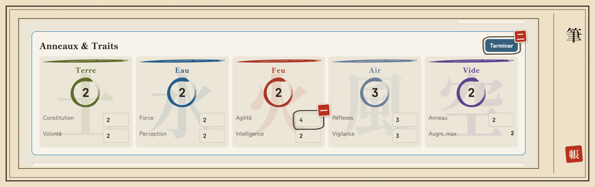
</picture>

- **一** (1) **Agilité** : un trait modifié ; l'Anneau et toutes les réserves suivent aussitôt.
- **二** (2) **Terminer** : repasse le bloc en lecture.

Sur téléphone, la même fiche tient sur une colonne :

<picture>
  <source media="(prefers-color-scheme: dark)" srcset="img/guide/sombre/04-fiche-mobile.png">
  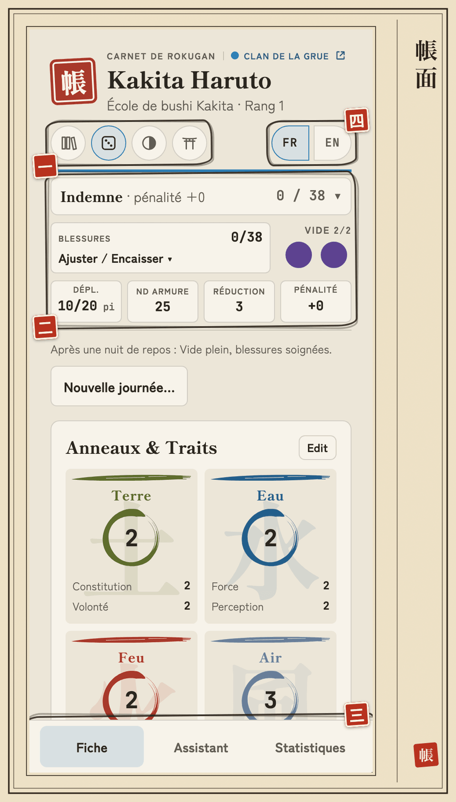
</picture>

- **一** (1) **Boutons ronds de l'en-tête** : Bibliothèque, lanceur de dés, thème, Ressources.
- **二** (2) **Barre d'état** : la même qu'à l'ordinateur, en plus compact.
- **三** (3) **Fiche · Assistant · Statistiques** : les onglets passent en bas de l'écran.
- **四** (4) **FR | EN** : la langue, au bout de la rangée.

### La barre d'état

<picture>
  <source media="(prefers-color-scheme: dark)" srcset="img/guide/sombre/04-barre-etat.png">
  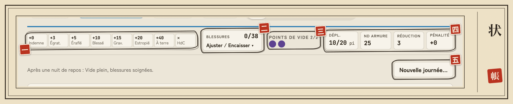
</picture>

- **一** (1) **Niveaux de blessure** : la piste des 8 niveaux et leur pénalité.
- **二** (2) **Blessures · Ajuster / Encaisser** : corriger, soigner ou encaisser un coup.
- **三** (3) **Points de Vide** : un appui dépense ou rend un point.
- **四** (4) **Dépl. · ND armure · Réduction · Pénalité** : tes valeurs du moment.
- **五** (5) **Nouvelle journée…** : après une nuit de repos.

| Tuile | Ce qu'elle montre | Un appui… |
|---|---|---|
| **Blessures** `2/38` | blessures subies / maximum, piste des 8 niveaux avec leur pénalité | ouvre **Ajuster** (`−` / `+` : corrections, soins) et **Dégâts de l'attaque** (Réduction et Vide appliqués, **Encaisser**) |
| **Points de Vide** | une pastille par point | dépense ou rend un point |
| **Dépl.** `10/20 pi` | action libre / action simple | — |
| **ND armure**, **Réduction** | valeurs en cours | ouvre l'éditeur d'armure |
| **Pénalité** | en rouge dès qu'elle dépasse `0` | — |
| **Sorts** (shugenja) | emplacements restants du jour par élément | ouvre l'éditeur ([§ 7](#7-shugenja--sorts-et-magie)) |

Sur mobile, un appui sur le résumé des blessures ouvre le détail : une ligne par niveau, avec l'intervalle de blessures. Les niveaux suivent le livre : Indemne jusqu'à `Terre × 5`, puis `Terre × 2` par niveau.

詳 · Pour aller plus loin : armure

Le bloc **Armure** affiche « armure du livre » ou « armure personnalisée », le **ND d'armure** en posture Attaque (`5 × Réflexes 3 + 5 + armure 5 = 25`, plus les bonus d'office de tes techniques), la **Réduction** (armure et techniques) et la **règle spéciale** de l'armure du livre. Son bouton **Edit**, comme les tuiles **ND armure** et **Réduction**, ouvre l'éditeur : nom, bonus au ND, Réduction.

La liste **Armure du livre** remplit ces trois champs : aucune, ashigaru, légère, lourde, cavalerie. Effets :

- armure légère : `+5` au ND d'Athlétisme et de Discrétion ;
- armure lourde : `+5` au ND des jets d'Agilité et de Réflexes (sauf école Hida) ;
- cavalerie : `+12` au ND d'armure à cheval, et comme une lourde à pied.

Retoucher ensuite le bonus ou la Réduction en fait une **armure personnalisée**, sans effet.

詳 · Pour aller plus loin : Insight, armes, anciens noms de compétence

- **Insight** : le bloc **Identité** calcule tes points (somme des Anneaux × 10, plus les rangs de toutes tes compétences, spécialisations non comprises), affichés `125 · Rang 1`. Rang 1 sous 150 points, puis un rang tous les 25 points (Rang 2 à 150, Rang 3 à 175…), au plus 10. **Bonus d'Insight (MJ)** ajoute les points accordés hors calcul. Le **Rang d'Insight que tu saisis fait foi** pour tous les calculs (initiative, soins, rang d'école…) : s'il diffère du calcul, une étiquette le signale (« Rang saisi 3 · calculé 1 »), sans rien bloquer.
- **Armes** : une arme du livre saisie avec d'autres valeurs (VD, mots-clés) est signalée ; **Mettre à jour** reprend celles du livre.
- **Vocabulaire** : les libellés suivent l'édition française (trait **Vigilance**, compétences **Courtisan**, **Discrétion**, **Représentation : Conte**, **Représentation : Art oratoire**, spécialisation **Courtoisie** d'Étiquette). Une fiche avec les anciens noms (Courtoisie, Furtivité, Conteur, Éloquence, Politesse) marche telle quelle ; un bandeau propose **Mettre à jour…** : aperçu, puis **Renommer** (annulable tout de suite) ou **Plus tard**.

## 五 · Savoir où l'on se tient : l'Assistant L5R

*« Avant de tirer la lame, sache où tu te tiens. »*

L'onglet **Assistant L5R** (**Assistant** dans la barre du bas sur mobile) propose les jets de chaque situation. Choisis la situation, touche une action : le lanceur s'ouvre ([§ 6](#6-le-lanceur)).

<picture>
  <source media="(prefers-color-scheme: dark)" srcset="img/guide/sombre/05-assistant.png">
  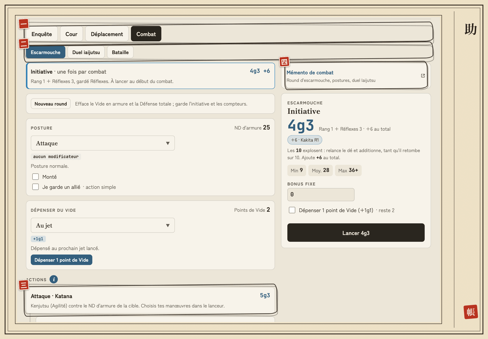
</picture>

- **一** (1) **Enquête · Cour · Déplacement · Combat** : la situation du moment (et **Magie** pour un shugenja).
- **二** (2) **Escarmouche · Duel iaijutsu · Bataille** : le type de combat.
- **三** (3) **Attaque · Katana** : une action, avec sa réserve ; un appui ouvre le lanceur.
- **四** (4) **Mémento de combat** : l'aide de jeu du portail, dans un nouvel onglet.

| Situation | Ce que tu y trouves |
|---|---|
| **Enquête** | Remarquer, fouiller, interroger, percer un mensonge, Courtisan, Étiquette, **Se souvenir** (une action par compétence `Connaissance : …`), **Méditer** (dans Repos) |
| **Cour** | Courtisan, Étiquette, Sincérité, Intimidation, Tentation, Comédie, Commerce, **Se produire** (une action par `Représentation : …`) |
| **Déplacement** | Distances en combat (pieds et mètres), Athlétisme, Équitation, Discrétion, Chasse, marche forcée |
| **Combat** | **Escarmouche**, **Duel iaijutsu**, **Bataille** |
| **Magie** | Shugenja seulement ([§ 7](#7-shugenja--sorts-et-magie)) |

**Méditer** (Méditation/Vide ND 20) : le bouton **Réussi** te rend 1 point de Vide, 2 avec Méditation 3, 3 avec Méditation 7.

Une action que ta posture interdit est **grisée** avec la raison ; **Lancer quand même** reste possible. Quand tu connais tes actions par cœur, le **« i »** à côté du titre **Actions** masque leurs explications (réglage mémorisé pour toutes tes fiches) ; les autres **« i »** masquent le détail du Vide, du déplacement, de la bataille et des rappels d'école.

### Escarmouche

<picture>
  <source media="(prefers-color-scheme: dark)" srcset="img/guide/sombre/05-escarmouche.png">
  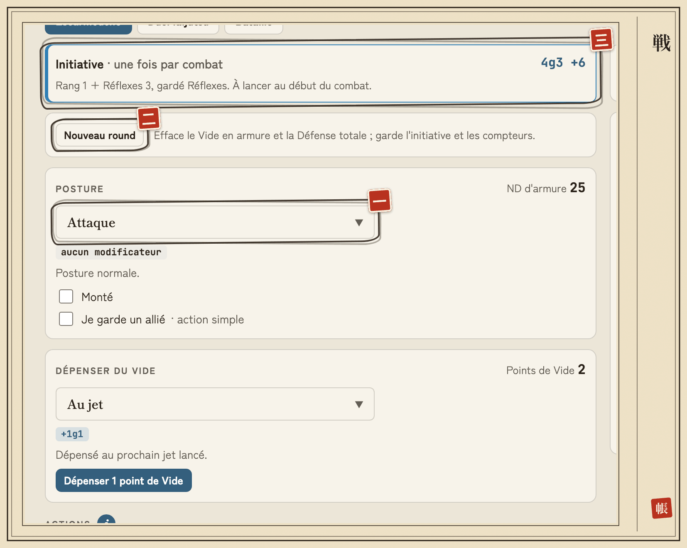
</picture>

- **一** (1) **Posture** : Attaque, Assaut, Défense, Défense totale ou Centre ; le ND d'armure suit.
- **二** (2) **Nouveau round** : efface le Vide en armure et la Défense totale.
- **三** (3) **Initiative** : à lancer une fois, au début du combat.

De haut en bas, dans l'ordre d'un round :

1. **Initiative** : à lancer au début du combat ; ton score s'affiche ensuite.
2. **Nouveau round** : efface le Vide en armure et la Défense totale, **garde l'initiative et les compteurs**.
3. **Posture** : ses effets s'affichent et le **ND d'armure** suit. Dessous : **Monté** et **Je garde un allié**.
4. **Dépenser du Vide** : choisis la dépense, puis **Dépenser 1 point de Vide** ; **Annuler** rend le point.
5. **Attaques** de chaque arme, avec leurs **dégâts** juste dessous (`└`). Un shugenja voit ses **sorts** juste après l'Initiative.

Pour **encaisser** un coup : tuile **Blessures** → **Dégâts de l'attaque**.

詳 · Pour aller plus loin : postures, Vide, Centre, Feinte

- **Initiative** : `+10` au round qui suit le Centre, `+10` par point de Vide dépensé pour l'escarmouche.
- **Postures interdites** : pas d'attaque en Défense, pas de tir en Assaut, rien d'autre que l'Initiative en Centre ; pas d'Assaut à cheval sans Équitation 3. Un shugenja ne lance pas de sort en **Assaut** ni en **Défense totale**.
- **Je garde un allié** : ton ND d'armure `−5`, le sien `+10`.
- **Dépenses de Vide** : `+1g1` au jet, `+10` au ND d'armure, compétence jouée au rang 1, capacité payée en Vide, `+10` à l'Initiative ou échange d'Initiative. Choisir ne dépense rien.
- **Bonus de Centre** : au round qui suit le Centre, le lanceur le propose (`+1g1` et ton Anneau de Vide au total, sur un seul jet) ; il vaut aussi pour un jet de sort.
- **Feinte** réussie : son bonus est pré-rempli sur les dégâts.
- **Encaisser** retire ta Réduction (et `10` avec un point de Vide), puis ajoute les blessures.

### Duel iaijutsu

Les étapes **Évaluation → Concentration → Frappe** remplacent l'initiative et la posture (Centre implicite). Coche une Évaluation **gagnée de 10 ou plus**, saisis l'**écart de Concentration** : les augmentations gratuites passent sur la Frappe.

### Bataille de masse

Pas d'initiative ; le panneau suit un tour de bataille :

1. **État de l'armée** : **Gagne**, **Égalité** ou **Perd**, selon le MJ. Si tu commandes, coche **Je commande l'armée** et saisis l'écart de ton jet de Commandement (Bataille/Perception) sur le commandant adverse (`5` d'écart pour gagner ou perdre).
2. **Engagement** : Réserve, Désengagé, Engagé ou Fortement engagé.
3. **Jet de bataille** : `1d10` (sans explosion) `+ Eau + Bataille` ; saisis ton total, ou **Lancer 1d10**. **Tacticien** ajoute `+5` ou `−5`.
4. **Résultat** : la case de la table du livre (« 2 dés de blessures, 1 Gloire, Duel »). Lance ces dés (sans explosion, additionnés), puis **Encaisser** : ta Réduction s'applique.

**Nouveau round** efface le jet et garde ton engagement.

## 六 · La chute des dés : le lanceur

*« Les dés tombent où ils veulent ; le samouraï sait déjà ce qu'il risque. »*

Choisir une action ouvre le **lanceur** (un panneau qui monte du bas sur mobile).

<picture>
  <source media="(prefers-color-scheme: dark)" srcset="img/guide/sombre/06-lanceur.png">
  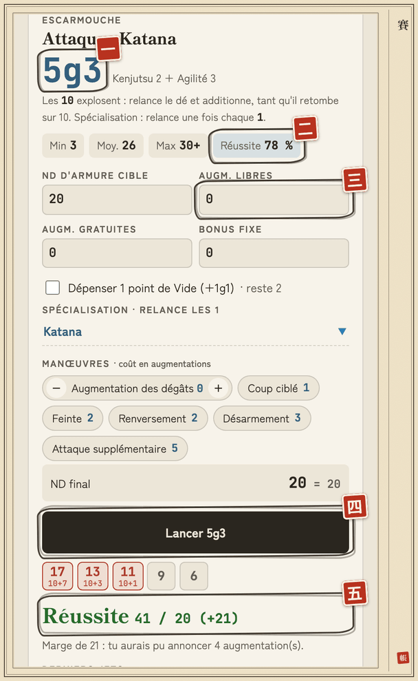
</picture>

- **一** (1) **Réserve** : `5g3` = 5 dés lancés, 3 gardés.
- **二** (2) **Réussite** : ta chance de réussite contre le ND final.
- **三** (3) **Augm. libres** : les augmentations que tu annonces, `+5` au ND chacune.
- **四** (4) **Lancer** : l'outil lance les dés pour toi.
- **五** (5) **Résultat** : les dés gardés, le total contre le ND et la marge.

Le lanceur donne aussi **Min · Moy. · Max**, les augmentations gratuites, le bonus fixe, le point de Vide, la **spécialisation** (elle relance les `1`), les manœuvres des attaques, et la ligne **« lancer à la main »** : les règles de relance pour **jouer avec tes propres dés** (« Les `10` explosent… », bonus à ajouter au total). Les augmentations sont limitées par ton Anneau de Vide.

**Dés de l'outil ou vrais dés ?** Par défaut, l'outil lance les dés : bouton **Lancer**, résultat et historique. Pour jouer avec tes dés, appuie sur **Lanceur de dés** dans l'en-tête (l'icône de dé sur mobile) pour le masquer. Le choix est mémorisé.

> Avec le lanceur de dés affiché, une attaque réussie avec **Augmentation des dégâts** pré-remplit les dés en plus sur le jet de dégâts (étiquette « +2g0 · augmentations de l'attaque », que **Retirer** annule).

## 七 · La parole des kami : shugenja, sorts et magie

*« Les kami entendent ceux qui savent ce qu'ils demandent. »*

Tout ce qui concerne la magie, de la saisie des sorts au lancer. La section apparaît pour une **école de shugenja** ([§ 8](#8-écoles-maîtrises-et-bonus)) ou dès qu'un sort est noté.

<picture>
  <source media="(prefers-color-scheme: dark)" srcset="img/guide/sombre/07-magie-mobile.png">
  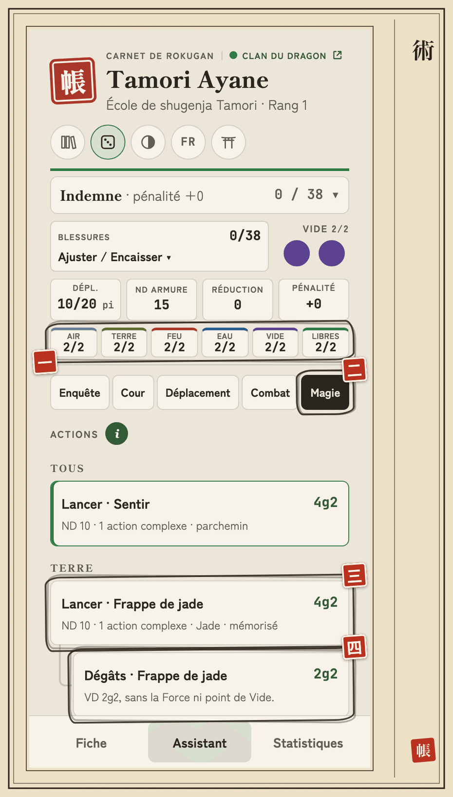
</picture>

- **一** (1) **Sorts** : tes emplacements restants du jour, par élément.
- **二** (2) **Magie** : la situation qui réunit tes sorts.
- **三** (3) **Lancer · Frappe de jade** : un sort, avec sa réserve, son ND et son temps d'incantation.
- **四** (4) **Dégâts · Frappe de jade** : le jet de dégâts, pour un sort qui a une VD.

### Noter tes sorts

<picture>
  <source media="(prefers-color-scheme: dark)" srcset="img/guide/sombre/07-sorts.png">
  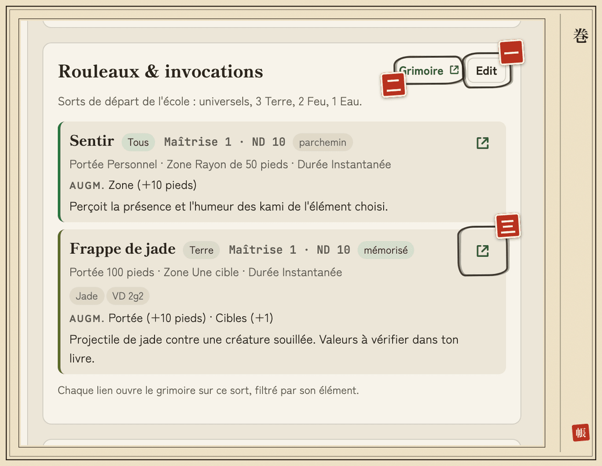
</picture>

- **一** (1) **Edit** : passe le bloc en saisie, avec **+ Sort** et **Ajouter depuis le grimoire**.
- **二** (2) **Grimoire** : le grimoire du portail, dans un nouvel onglet.
- **三** (3) **Icône du sort** : ouvre le grimoire sur ce sort, filtré par son élément.

La section **Rouleaux & invocations** (après Techniques d'école) montre une carte par sort, triée par élément puis maîtrise, et en tête le rappel des **sorts de départ** de l'école. Le Carnet ne contient **aucun catalogue de sorts** : tu les ajoutes de deux façons, en **Edit**.

- **Depuis le grimoire** (le plus rapide) : **Ajouter depuis le grimoire** → **Charger le grimoire** la première fois (environ 110 Ko, gardé ensuite dans ce navigateur, même hors ligne). Cherche par nom (français ou anglais), filtre par élément, **+ Ajouter** (ou Entrée). Complète ensuite l'**effet**, la case **Mémorisé** et souvent la **VD**, que le grimoire ne donne pas encore.
- **À la main** : **+ Sort**, et recopie le sort de ton livre avec tes mots. **Ajouter les sorts universels** ajoute Sentir, Communier et Invoquer (élément « Tous »).

**Autocomplétion** : grimoire chargé, tape au moins deux lettres dans le champ **Nom** d'un sort ; ↑ ↓ pour choisir, Entrée ou clic pour remplir.

詳 · Pour aller plus loin : grimoire et autocomplétion

- Un sort déjà noté est marqué « déjà noté ». **Actualiser**, à droite des boutons, recharge le grimoire. Rien n'est envoyé. Grimoire chargé, **Ajouter les sorts universels** les remplit aussi. Sans connexion, tout reste possible à la main.
- Un sort ajouté arrive en fin de liste avec son nom, son élément, sa maîtrise, sa portée, sa zone, sa durée, ses mots-clés et ses augmentations.
- L'autocomplétion propose jusqu'à huit sorts ; Échap ferme la liste, ↓ l'ouvre sur un nom déjà saisi. Elle remplace le nom, l'élément, la maîtrise, puis la portée, la zone, la durée, les mots-clés, les augmentations et la VD (si le grimoire la donne). L'effet et **Mémorisé** ne changent jamais.
- Si tu avais déjà saisi d'autres valeurs, le Carnet te les montre d'abord : **Remplacer**, **Compléter les vides** (garde tes valeurs) ou **Annuler** (rien ne change, ton nom compris). Un nom absent du grimoire est accepté tel quel.
- Sans grimoire chargé, la ligne **charger le grimoire** sous le nom le charge sans ouvrir le panneau.
- Carte d'un sort : élément, `Maîtrise 2 · ND 15`, **mémorisé** ou **parchemin**, portée, zone, durée, mots-clés, VD, augmentations et effet.

### Emplacements du jour

La ligne **Sorts** de la barre d'état montre tes emplacements restants, `restants/max`, en **Air, Terre, Feu, Eau, Vide** (un par point d'Anneau) et **Libres** (autant que ton Anneau de Vide, pour n'importe quel élément). Un appui ouvre l'éditeur (`−` dépense, `+` rend). **Nouvelle journée…** les recharge.

### Lancer un sort

Onglet **Assistant L5R** → **Magie** : une carte **Lancer** par sort, groupées par élément, avec la réserve `(Anneau + rang d'école ±1) g Anneau`, le ND (`5 + 5 × maîtrise`) et le temps d'incantation. **Dégâts** apparaît si le sort a une VD (sans la Force ni point de Vide). En Escarmouche, tes sorts sont dans le groupe **Sorts**.

- La ligne **Emplacement** du lanceur dit quel emplacement le sort prendra : `Feu 2/3`, `libre 1/2` si l'élément est épuisé, ou **aucun emplacement** en rouge.
- Un lancer, réussi ou raté, **dépense l'emplacement** : bouton **Lancer**, ou **Réussi** / **Raté** avec tes propres dés. Un sort réussi puis **interrompu** ne le consomme pas : **Annuler (interrompu)** le rend.
- Un sort que ton rang ne permet pas (maîtrise trop haute, élément de déficience au rang 1) est grisé avec sa raison ; **Lancer quand même** reste possible.
- **Rester concentré** (en fin de liste) : jet de Volonté, ND 10, ou 5 + les dégâts subis que tu saisis, après une interruption.

詳 · Pour aller plus loin : ce que le lanceur affiche pour un sort

- L'origine de la réserve (« Terre 3 + rang 1 + affinité 1 ») et le ND fixé par la maîtrise.
- Sous les augmentations : l'élément à choisir pour un **sort universel**, les **cases de ton école** (cible non humaine, il fait jour…), ses **augmentations gratuites** appliquées d'office (mot-clé Jade, élément d'affinité d'Isawa), **Augm. pour le temps d'incantation**, les augmentations du sort, et les rappels (parchemin si le sort n'est pas mémorisé, jet de Volonté si tu es interrompu, effet).
- L'école **Agasha** peut lancer avec un autre Anneau : le point de Vide est dépensé au lancer.
- La maîtrise **Sortilèges 5** ajoute `+1g0` aux jets de sort.
- **Affinité et déficience** : le bloc Techniques d'école les affiche (« Affinité Terre · Déficience Air ») ; le rang de lancement gagne `+1` dans l'élément d'affinité et perd `1` dans celui de déficience. L'école **Isawa** fait choisir son affinité (Vide compris) dans **Affinité (shugenja)** du bloc Identité. Chaque école a sa technique au rang 1 ; les rangs suivants apportent de nouveaux sorts.

## 八 · L'héritage des maîtres : écoles, maîtrises et bonus

*« L'école forme la main ; la main n'oublie pas. »*

Choisis ton école et le Carnet applique le reste : techniques, maîtrises et bonus comptent **d'eux-mêmes** dans les réserves de la fiche, de l'Assistant et des statistiques.

- **École** : en **Edit**, bloc Identité → **Techniques d'école**. **École (nom affiché)** prend le nom du livre, modifiable ensuite. Le **Rang d'école** vaut ton Rang d'Insight, sauf si tu le changes ; l'en-tête affiche « École de bushi Kakita · Rang 1 ».
- **Maîtrises de compétence** : appliquées selon le rang de **chaque compétence**, quelle que soit ton école. Dans le lanceur, elles portent le badge **Maîtrise** (« `+1g0` · Kenjutsu 3 »).
- **Bonus de jet** : pour un avantage, un désavantage ou une technique hors catalogue (kata…), le panneau **Bonus de jet** de la fiche (en **Edit**).

Ce qui dépend de la situation **se coche** : dans le lanceur (**Techniques à cocher**) ou dans le panneau **Posture**. Ce qui n'a pas d'effet chiffré apparaît dans **Rappels d'école**, en Combat comme à la Cour.

詳 · Pour aller plus loin : les 40 écoles

- **14 écoles de bushi** : Hida, Hiruma, Kakita, Daidoji, Mirumoto, Togashi, Akodo, Matsu, Yoritomo, Tsuruchi, Shiba, Bayushi, Moto, Utaku ;
- **10 écoles de courtisans** : Yasuki, Doji, Kitsuki, Ikoma, Yoritomo, Asako, Bayushi, Ide, Otomo, Miya ;
- **2 écoles Shosuro** : Infiltré et Acteur ;
- **14 écoles de shugenja** : Kuni, Asahina, Tamori, Kitsu, Moshi, Isawa, Agasha, Soshi, Iuchi, Seppun, et dans le groupe **Clans mineurs** Komori (Chauve-souris), Tonbo (Libellule), Kitsune (Renard), Chuda.

詳 · Pour aller plus loin : comment les techniques s'appliquent

- Les techniques de ton rang comptent dans les réserves avec la posture Attaque comme référence.
- Les techniques **situationnelles** se cochent dans le lanceur ou dans le panneau **Posture** (cases de ND d'armure, compteurs de touches, case **Monté**).
- Les techniques qui agissent **sur les autres** sont rappelées avec leur valeur, sur la fiche et sous la réserve des jets sociaux (« `+10` au ND de qui te ment »).
- Certaines dépendent de la **spécialisation** choisie au lanceur : Duperie ou Honnêteté pour Ide, Contrôle pour Yoritomo, Duperie pour Shosuro Acteur.
- Les armes ont des **mots-clés** (Samouraï, Lourde, Petite, Arc…), pré-remplis pour les armes connues : ils décident des techniques qui s'appliquent.
- Une fiche d'une version précédente propose d'**associer** l'école reconnue dans son nom (« Associer à École de bushi Kakita ? ») : **rien ne change sans ta confirmation**.

詳 · Pour aller plus loin : exemples de maîtrises

Kenjutsu 3 donne `+1g0` aux dégâts des épées et Kenjutsu 7 les fait exploser sur 9 ; Défense 5 ajoute `+3` au ND d'armure en Défense ; Bataille 5 ajoute son rang à l'Initiative ; Athlétisme 3 et 5 effacent la pénalité de terrain ; toute compétence au rang 10 gagne une augmentation gratuite. Celles qui dépendent de la situation (Armes d'hast) se cochent, celles sans effet chiffré rejoignent les **rappels**.

詳 · Pour aller plus loin : saisir un bonus de jet

- À la main, à partir d'une **forme d'effet** classée par source : **avantage** (dés en plus, augmentation gratuite, pénalité de blessure réduite…), **désavantage** (malus de dés, ND augmenté…), **technique** (dés en plus aux attaques, aux dégâts, en posture…) ou **bonus libre** ; tu écris le nom de ton avantage ou de ta technique.
- Ou dans le JSON de ta fiche (champ `modifiers`) : voir les modèles de fiche de la Bibliothèque.

Un bonus **« d'office »** compte dans toutes les réserves ; un bonus **« au choix »** se coche dans le lanceur quand sa condition est remplie.

## 九 · Le compte des chances : statistiques

*« Connais tes chances avant de les tenter. »*

La page **Statistiques**, à côté de **Fiche** et **Assistant L5R** (dans la barre du bas sur mobile), donne pour **tous tes jets** la réserve, le minimum, la moyenne, le maximum et la **chance de réussite** contre un ND de `10` à `40`.

<picture>
  <source media="(prefers-color-scheme: dark)" srcset="img/guide/sombre/09-stats.png">
  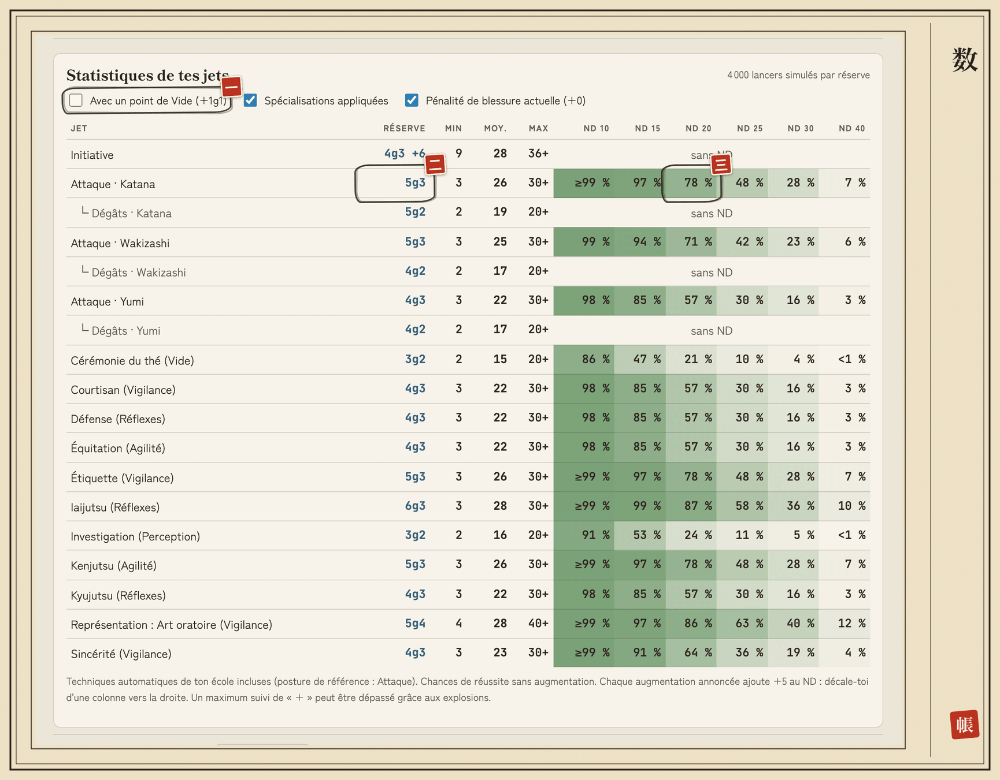
</picture>

- **一** (1) **Avec un point de Vide (+1g1)** : recalcule tout le tableau avec un point de Vide dépensé.
- **二** (2) **Réserve** : `5g3` pour l'Attaque · Katana.
- **三** (3) **ND 20** : 78 % de chances de réussir contre un ND de 20.

- Trois cases : **Avec un point de Vide (+1g1)**, **Spécialisations appliquées**, **Pénalité de blessure actuelle**.
- Un shugenja y trouve aussi une ligne par sort (`Sort · Frappe de jade (Terre)`), et ses dégâts.
- Chaque augmentation ajoute `+5` au ND : décale-toi d'une colonne vers la droite.

## 十 · La copie des rouleaux : sauvegarder et changer d'appareil

*« Ce qui n'est écrit qu'une fois peut être perdu. Fais une copie de tes rouleaux. »*

<picture>
  <source media="(prefers-color-scheme: dark)" srcset="img/guide/sombre/10-fichier.png">
  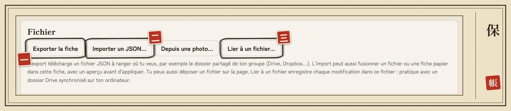
</picture>

- **一** (1) **Exporter la fiche** : télécharge ta fiche en JSON, ta sauvegarde.
- **二** (2) **Importer un JSON…** : fusionne un fichier dans cette fiche, après un aperçu.
- **三** (3) **Lier à un fichier…** : enregistre chaque modification dans un fichier de ton choix (Chrome et Edge sur ordinateur).

| Besoin | Comment |
|---|---|
| **Sauvegarder** | bloc **Fichier** → **Exporter la fiche** : un fichier JSON (`kakita-haruto-l5r.json`), à ranger où tu veux, par exemple dans le **dossier partagé de ton groupe** |
| **Sauvegarder en continu** (Chrome et Edge sur ordinateur) | **Lier à un fichier…** : chaque modification est écrite dans le fichier choisi, par exemple dans un dossier Drive synchronisé |
| **Changer d'appareil** | export sur l'ancien, puis sur le nouveau : Bibliothèque → **Importer un JSON…** → destination **Nouvelle fiche** |
| **Mettre à jour une fiche** | **Importer un JSON…** dans la fiche ouverte : il **fusionne**, après un **aperçu** des modifications, ajouts et avertissements. **Rien n'est jamais supprimé** par une fusion |

詳 · Pour aller plus loin : fichier lié

- Après un rechargement, le navigateur redemande la permission : clique sur **Reprendre l'enregistrement**.
- Si le fichier a été modifié ailleurs, l'outil te laisse choisir : **Charger la version du fichier**, **Écraser avec ma version**, ou **Fusionner** après un aperçu.
- **Délier** retire le lien sans toucher au fichier.

## 十一 · Le regard du MJ : pour le MJ

*« Celui qui juge lit les rouleaux sans y poser le pinceau. »*

Importe les fichiers JSON des joueurs en **Consultation** (Bibliothèque → **Importer un JSON…**, ou **dépose le fichier sur la page**) :

- la fiche est en **lecture seule** : rien n'y est modifiable ;
- l'aide aux jets reste utilisable, **sans rien dépenser** (points de Vide) ;
- **Rendre modifiable** en crée une **copie**, si besoin.

Pour mettre à jour la fiche d'un joueur, **importe son nouveau fichier**.

## 十二 · Langues, portail et discrétion : langue, portail et confidentialité

*« Chaque voix a sa langue ; ce qui est confié reste au foyer. »*

### Langue

<picture>
  <source media="(prefers-color-scheme: dark)" srcset="img/guide/sombre/12-en-tete.png">
  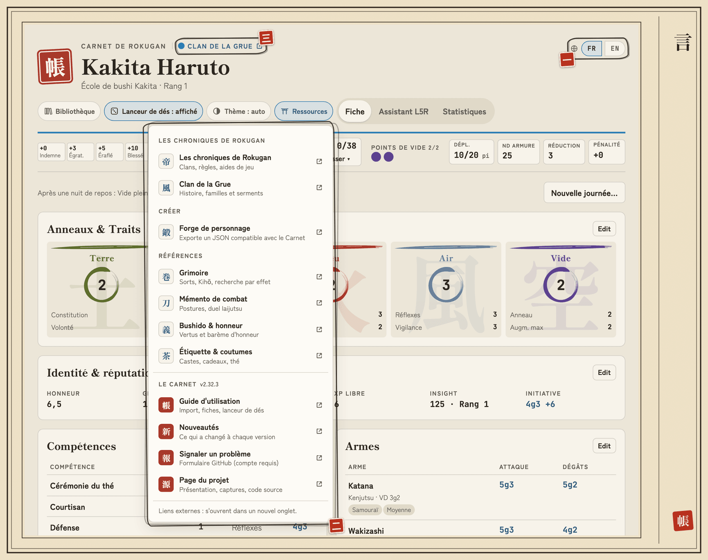
</picture>

- **一** (1) **FR | EN** : la langue ; celle qui est surlignée est active.
- **二** (2) **Ressources** : le bouton ; son menu ouvre le portail, ce guide et les nouveautés, chacun dans un nouvel onglet.
- **三** (3) **Clan de la Grue** : la page de ton clan sur le portail.

Le Carnet s'ouvre dans la langue de ton navigateur, français ou anglais. La bascule **FR | EN**, en haut à droite de l'en-tête (au bout de la rangée de boutons sur téléphone), change de langue ; le choix est mémorisé. **Tes fiches ne sont jamais traduites** : ce que tu as saisi reste tel quel.

詳 · Pour aller plus loin : le Carnet en anglais

En anglais, les réserves s'écrivent `5k3`, les distances sont en pieds, et les règles de l'Assistant (anneaux, blessures, postures, actions, explications) sont en anglais ; les 40 écoles, leurs techniques, les maîtrises et les modèles de fiche aussi ; le grimoire et les pages du portail restent en français, marqués **(FR)** dans le menu **Ressources**. Une fiche saisie avec les noms anglais des compétences (Stealth, Courtier, Lore: History…) fonctionne comme une fiche française : techniques d'école et maîtrises la reconnaissent.

### Les chroniques de Rokugan

Un site de fan indépendant (catalogues, Forge de personnage, grimoire), utilisable par n'importe quel groupe ; ce n'est pas forcément le site de ton MJ. La **Forge** est une création guidée : elle calcule l'XP, les traits et les bonus d'école, et exporte un JSON à importer ici avec **Importer un JSON**.

Le bouton **Ressources** (icône de torii, en haut) ouvre les liens vers ce portail, chacun dans un **nouvel onglet**. Le Carnet ne contacte jamais ce site de lui-même et marche toujours hors ligne ; seule exception, quand tu la demandes : **Charger le grimoire**.

詳 · Pour aller plus loin : tous les liens

- Menu **Ressources** : la page d'accueil, la page de ton clan (si une fiche est ouverte), la **Forge de personnage**, le **Grimoire**, le **Mémento de combat**, **Bushido & honneur** et **Étiquette & coutumes**.
- Ailleurs : le **nom du clan**, au-dessus du nom du personnage, ouvre la page du clan ; dans **Rouleaux & invocations**, **Grimoire** ouvre le grimoire et l'icône de chaque sort le cherche par son nom et son élément ; dans l'**Assistant L5R**, un encadré propose le **Mémento de combat** en Combat, **Étiquette & coutumes** et **Bushido & honneur** en Cour.
- Le menu se termine par la section **Le Carnet**, avec le numéro de version : ce **guide**, les **nouveautés**, **signaler un problème** (compte GitHub requis) et la **page du projet**. Ces liens sont aussi en **pied de page**, avec **Contact** (message privé à l'auteur). La Bibliothèque vide propose **Lire le guide** dès la première visite. En anglais, le lien du guide mène au guide anglais.

### Confidentialité

Tes fiches et le nom de tes personnages **ne partent jamais**. L'adresse web compte les visites avec [GoatCounter](https://www.goatcounter.com), sans cookie : à chaque ouverture, il reçoit l'adresse de la page, le site d'où tu viens, ton navigateur, ta langue et la taille de ton écran. Ton adresse IP sert à déduire ton pays et n'est pas conservée. Si un bloqueur de publicité l'arrête, le Carnet marche à l'identique, et le fichier `carnet-l5r.html` ne compte rien.
